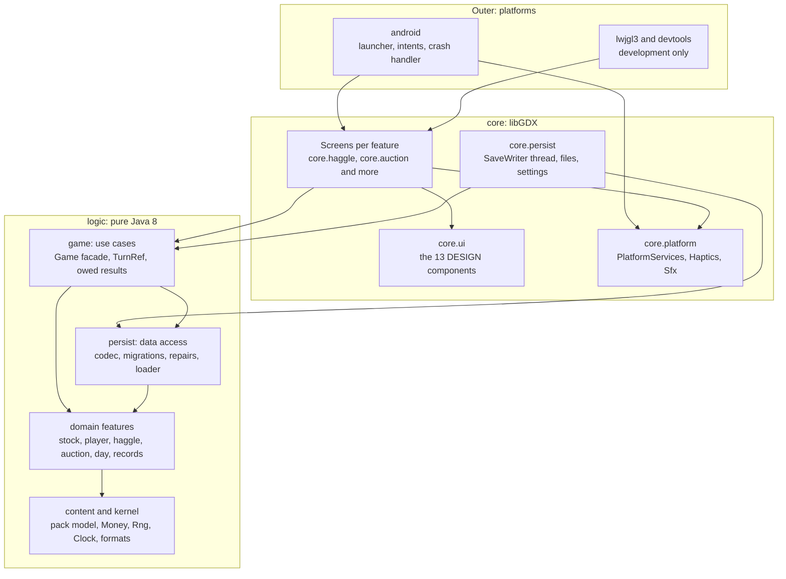
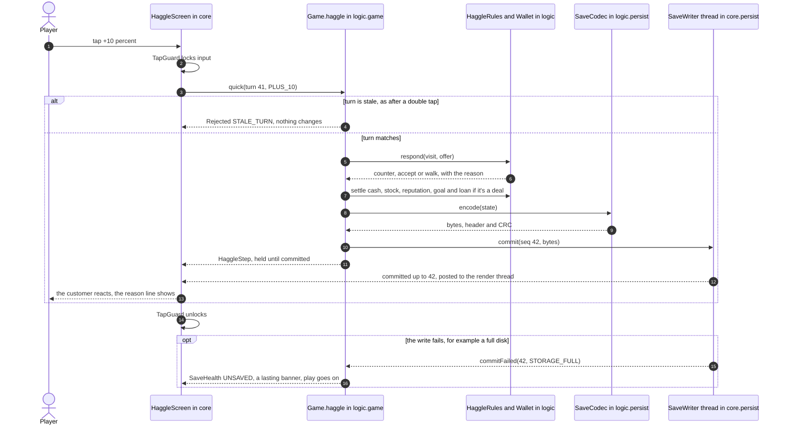

# Bazaar Boss: Haggle Tycoon — Low-Level Design

How the code is split, which way dependencies point, where each rule lives, how errors travel, what's shared, the paths that must be fast, and how each level is tested. Written 2026-11-25 from [PRD.md](PRD.md) §7, [TRD.md](TRD.md), [APP-FLOW.md](APP-FLOW.md), [DESIGN.md](DESIGN.md), [EDGE-CASES.md](EDGE-CASES.md), [MONETISATION.md](MONETISATION.md) and IDEA.md's Hardening decisions (H1–H5).

- **Java 8 API** (`--release 8`, TRD §1.2): no records, sealed types or switch expressions. Plain final classes, static factories, enums.
- **Names** are the ones the code will use. A finding marked **→ TRD** is a change this file proposes to the TRD (§11).

---

## 0. The shape in one page

**One player, one phone, one process, no server.** The "API" is an in-process façade, the "database" is one JSON document, and Google's servers are configured, not coded (TRD §2).

**What this design keeps, because it pays here:**
- **The dependency rule.** `logic` is pure Java and never sees libGDX's renderer, Android or a screen. The simulator, the haggle lab and every unit test run the real rules because of it (DR11, Check 3).
- **One door into the rules:** the `Game` façade. Screens send commands and get back views. They never touch `GameState`.
- **Every PRD §7 rule in one class** (§2.4), with a test named after it.
- **Typed outcomes for everything expected**, crashes for bugs (§4).
- **Ports for every outside service:** files, the clock, Android's intents, haptics, sound; later, billing and ads.

**What it leaves out, and why:**

| Pattern | Why not here |
|---|---|
| A dependency-injection framework | About 20 objects, wired by hand in one place (`BazaarBossGame.create`). Annotation processing slows the build, and reflection breaks under R8 (SV-1) |
| A repository per entity | There's one document (TD-04). One `SaveFiles` port covers it |
| An event bus | It hides control flow. The only asynchronous edge is the save writer's callback, posted to the render thread |
| A presenter or view-model per screen | The views `logic` returns already *are* the view-models. A second layer would copy them |
| A use-case class per command | Commands are grouped per feature (`HaggleCommands` and so on): ~25 commands, 6 classes |
| Mappers between layers | Views are built once, in the feature that owns the rule. The codec is the only other mapping |
| Server layers, an ORM, reactive streams | No server, no database, one thread owns the state (TRD §8) |
| Interfaces for domain classes | Only outside services and test seams get interfaces. `Rng` is a concrete class with a seed: the seed is the seam |

---

## 1. ⭐ The modules, split by feature

**Two kinds of split:**
- **Gradle modules** carry the layers and the platforms. That's what makes the dependency rule a compile error, not a convention.
- **Packages inside them** carry the features. A feature is a vertical slice: its rules and entities in `logic`, its screens in `core`, under the same name.

| Gradle module | Ships? | Holds | May depend on |
|---|---|---|---|
| `logic` | Yes | `kernel`, `content`, the domain features, `game` (use cases), `persist` (the codec) | libGDX's pure-Java JSON utilities, in `persist` only (§2.3) |
| `core` | Yes | The libGDX game: the app shell, the DESIGN components, art, text, sound, screens per feature, the save writer, and the platform ports | `logic`, libGDX |
| `android` | Yes | `AndroidLauncher`, the port implementations, FileProvider, the crash handler, the manifest and backup rules | `core`, AndroidX Core |
| `lwjgl3` | No | The desktop window, with stub ports that log | `core`, `devtools` |
| `devtools` → TRD | No | The dev menu, the haggle lab, the text test, the fixture loader. **New:** a module, so release builds can't contain them (PRD §6) | `core` |
| `sim` | No | The simulator and the bots (DR11, F11 AC4, Check 3) | `logic` |
| `tools` | No | The content validator and builder, the font baker, and the repo-wide guard tests (§7) | `logic` (to parse content exactly as the game will), gdx-freetype |

### 1.1 The features

"Endpoints" here are the commands of TRD §5.2: the only way anything changes.

| Feature | Owns: entities · screens · commands | Exposes to other modules | Must never reach into |
|---|---|---|---|
| **kernel** (shared) | `Money`, `Bp`, `BazaarSteps`, `IndianNumberFormat`, `Dates`, `Clock`, `Rng`, `Ids`, `Outcome`, `Rejected`, `Check`, `Limits` · — · — | Everything in it | Any other package |
| **content** | The read-only pack: `ContentPack`, `ItemDef`, `ClueDef`, `PersonalityDef`, `CustomerTypeDef`, `RegularDef`, `RivalDef`, `TierDef`, `MarketDef`, `TeaserDef`, `SpecialDef`, `LineId`, `Voice` · — · — | Lookups by permanent ID; `LineId`s | Game state; text (the words live in `core.text`) |
| **stock** | `OwnedItem`, `OfferedItem`, `Godown`, `Display`, clues and inspection, scrap · Inspect, Godown · `Inspect`, `PutOnDisplay`, `TakeOffDisplay`, `Scrap` | `ItemFactory`, `Godown`'s add, remove and reserve, `ScrapRules.priceOf`, `InspectView`, `GodownView` | Cash (asks `player`); visits and haggles |
| **player** | `PlayerState`: cash, the loan, reputation, the tier, goal progress · Low cash, Tier-up · `TakeLoan`, `CheapSellerDay`, `Upgrade` | `Wallet`, `Loan`, `Floor`, `Goal`, `Reputation`, `TierUpView` | Items, visits, auctions |
| **haggle** | `Visit`, `Haggle`, `Offer`, verdicts, lessons, personalities · Haggle, Deal result, Pause · `ServeVisit`, `Offer`, `Quick`, `AskLastPrice`, `Accept`, `WalkAway` | `VisitFactory`, `HaggleView`, `DealResult`, `WalkedAway`, `BadFaith` | The auction; the calendar; the clock (DR12) |
| **auction** | `Lot`, `Auction`, `RivalState`, `Reveal`, sort decisions · Auction, Reveal, Sort · `OpenAuction`, `SkipAuction`, `PlaceBid`, `AuctionTick`, `LeaveAuction`, `RevealNext`, `RevealAll`, `DecideSort` | `LotFactory`, `PeekView`, `AuctionView`, `AuctionResult`, `RevealView` | Visits; the calendar |
| **day** | `DayState`, the day plan, Today's special, teasers, welcome back, the kanakku · Stall (its states), Kanakku · `StartDay`, `EndDay`, `ClaimSpecial` | `MorningView`, `KanakkuView`, `StallView` (composed from the others' views) | Another feature's state, except through its exposed API |
| **records** | `Stats`, `Records`, regulars' memory, hints seen · — · `DismissHint`, `ShareStats` (no commit) | `Records.noteDeal`, `discover`, `StatsText` | Everything else: it's a sink |
| **game** (use cases) | `GameState` (the root), `TurnRef`, owed results, save health · — · Dispatches every command | The `Game` façade, views, `Outcome`, `SaveSink` (a port it declares) | libGDX; files; Android |
| **persist** (data access) | The file format, `SaveCodec`, `SaveMigrator`, `Invariants`, `Repairs`, `SaveLoader`, `ContentPackReader` · — · — | `SaveLoader.load`, `SaveCodec.encode`, `LoadOutcome`, the `SaveFiles` port | Screens; the rules (it stores state, never decides) |
| **shop** *(purchases, after G3)* | Owned product IDs, the cosmetic catalogue · Shop · `Buy`, `Restore` | `Catalogue`, `Entitlements`, `ShopView`, the `BillingPort` | **Cash, stock, reputation, progress (DR36)** |
| **ads** *(M4, only past ~3,000 installs a month)* | The age and consent record, the daily count, the reward nonce · Ad offers, Age, Consent, Ads & privacy · `RequestAd`, `RecordAge`, `SetConsent` | `AdGate`, `AdView`, the `AdPort` | Lots, prices, customers, outcomes (DR5) |

**In `core`, each feature has a package of the same name** (`core.haggle`, `core.auction` and so on) for its screens and cards. The shared parts are:
- `core.app`: the shell, router and back
- `core.ui`: the DESIGN components
- `core.text`, `core.art`, `core.audio`
- `core.persist`: the writer, files and settings
- `core.platform`: the ports

### 1.2 The folder tree

The package root is `io.github.rameshkumark24.bazaarboss`, written `…` below. Two moves happen in slice 1 (→ TRD):
- `core`'s code moves under `….core.*`; today `BazaarBossGame` sits in the root package.
- An `assets/` folder is added, wired into `android` and `lwjgl3` the way liftoff's template does it. There's none yet.

```
c:\Bazaar Boss Haggle Tycoon\
├─ CLAUDE.md · build.gradle · settings.gradle · gradle.properties · gradlew · .githooks/pre-push (§8)
├─ docs/                 PRD · TRD · APP-FLOW · DESIGN · EDGE-CASES · MONETISATION · LLD · IDEA · RESEARCH · COMPETITORS
│  └─ design/            palette.py · palette.json (generated by palette.py; read by a test, §9)
├─ content/              sources: strings.csv · items.json · customers.json · rivals.json · tiers.json · market.json
│                        tuning.json · teasers.json · specials.json · banned/*.txt · ids-ever-shipped.txt
├─ assets/               built by tools from content/ and the fonts; never edited by hand
│                        content/pack.json · strings/{en,tanglish,hinglish}.json · fonts/<step>/ · sfx/*.ogg
├─ logic/src/main/java/…/logic/
│  ├─ kernel/  content/  stock/  player/  haggle/  auction/  day/  records/
│  ├─ game/              Game · GameState · TurnRef · HaggleCommands … · OwedResults · SaveSink · SaveHealth · NewGame
│  ├─ persist/           SaveFormat · SaveCodec · SaveLoader · SaveFiles · LoadOutcome · Invariants · Repairs · ContentPackReader
│  │  └─ migrate/        V1ToV2 … one class per step; released steps are never edited
│  ├─ shop/              (purchases) Catalogue · Entitlements · BillingPort
│  └─ ads/               (M4) AdGate · AdCap · RewardNonce · Consent · AdPort
├─ logic/src/test/       mirrors main · rules/Dr08…Test.java
│  └─ resources/         saves/v<N>.json · replays/*.txt · fixtures/screens/<screen>-<state>.json
├─ core/src/main/java/…/core/
│  ├─ app/               BazaarBossGame · ScreenRouter · ModalQueue · BackDispatcher · LaunchRouter · TapGuard · RenderOnDemand
│  ├─ ui/                the 13 DESIGN components · style/ (Palette · Space · Type · Radius · Motion · Styles)
│  ├─ text/  art/  audio/  persist/  platform/
│  └─ firstrun/  stall/  haggle/  auction/  godown/  kanakku/  settings/  shop/  ads/
├─ android/src/main/     AndroidLauncher · AndroidPlatformServices · CrashHandler · res/xml/ (share_paths · data_extraction_rules · backup_rules)
├─ android/src/debug/    DevToolsHook: plugs devtools into debug builds only
├─ lwjgl3/  devtools/  sim/  tools/
├─ site/                 the waitlist page (not the app)
└─ shots/                screenshots (not in git)
```

---

## 2. ⭐ The layers and the dependency rule

### 2.1 Four layers, on the phone only

There is no server. Google's servers (Play Console, Play Billing, AdMob) are set up by hand and checked by the release checklist (IDEA H4), not coded.

| Layer | Here | What it does | What it may not do |
|---|---|---|---|
| **Screen** | `core.<feature>`, `core.app`, `core.ui` | Draws views, sends commands, keeps UI-only state: scroll, the slider before Offer, open cards, filters (TRD §8) | Decide anything a rule decides; hold an entity; touch a file |
| **Use case** | `logic.game` | Checks the turn (IN-1); calls the rules; settles effects across features (a deal moves cash, stock, reputation, goal, loan and records); makes **one commit per command**; records owed results (LC-3) | Draw; know about files or threads |
| **Domain rules** | `logic.kernel`, `logic.content`, the feature packages | Every rule in PRD §7, as plain Java on plain objects | Import libGDX, Android, files, threads or the wall clock; see `game` or `persist` |
| **Data access** | `logic.persist` (codec, loader); `core.persist` (writer thread, files, settings); `android` (intents, FileProvider) | Bytes in and out, through ports | Decide anything a rule decides |

### 2.2 Which way the arrows point



**How to read it:**
- An arrow means "depends on".
- `core.persist → game` because the writer *implements* `SaveSink`, a port `game` declares: the use-case layer never depends on files.
- `game → persist` is only for the pure codec (`SaveCodec.encode`). Bytes leave `logic` through the port.

**Inside the domain, features form a line, and each may use only those to its left:**

`kernel ← content ← stock ← player ← haggle ← auction ← day ← records`

- **haggle** uses `stock` (the item on the table) and `player` (affordability; reputation for new visits).
- **auction** uses `stock` (lots) and `player` (bids).
- **day** uses `haggle` and `auction` to plan who comes and what's sold.
- **records** only listens.
- **shop** and **ads** use `kernel` and `content` only. That makes DR5 and DR36 imports the compiler and the guard can see, not promises.

### 2.3 The guard that holds it

| What | Allowed | Checked by |
|---|---|---|
| `logic` → libGDX | Only `com.badlogic.gdx.utils.Json*`, and only inside `persist` | `tools` guard: `DependencyRulesTest` scans every `import` line. It refines TRD §4.11's logic-imports test |
| A domain feature → another | Only features to its left (§2.2); never `game`, `persist`, `shop` or `ads` | `DependencyRulesTest`, from a matrix kept in the test |
| `shop`, `ads` → anything | `kernel`, `content` | Same (DR5, DR36) |
| `core` → `logic` | `game.*`; classes named `*View`, `*Result` or `*Step`; `kernel` formats; `content.LineId` and `Voice`; `persist.LoadOutcome` | Same. **Never** an entity (`Visit`, `OwnedItem`, `GameState`) or a `*Rules` class |
| Who uses the clock | `day`, `records` and `ads` take a `Clock`. `haggle` and `auction` never do: patience counts rounds (DR12), and the auction counts elapsed time it's given | Same |

The guard is a plain JUnit test reading source files. ArchUnit would do it with more polish, but it's a new download for something 60 lines of test can hold.

### 2.4 Every PRD §7 rule, in exactly one place

A screen never repeats a rule. It renders what the view says, such as `HaggleView.quick[i].enabled` (F2 AC10), and never works it out again. Tests are named for the rule, so `rules/Dr08…Test` finds DR8.

| Rule | Lives in | Notes |
|---|---|---|
| DR1 one currency, earned only by playing | `player.Wallet`: the only class that changes cash; its credit methods are named for game events | `shop` and `ads` can't import it (§2.3) |
| DR2 cash never below ₹0 | `player.Wallet.debit` and `maxAffordable` | Views carry `maxAffordable`; sliders read it |
| DR3 the loan | `player.Loan`: take, repay on each sale (at least ₹1), one open | — |
| DR4 a way forward | `player.Floor`: `isBroke`, the cheap-seller day; `day.DayPlanner` asks it for an affordable seller | No dead end: `sim` proves it (F11 AC4) |
| DR5 nothing depends on spend or ads | Structural: `haggle`, `auction` and `day` can't import `shop` or `ads` | `DependencyRulesTest` |
| DR6, DR9 the walk-away price: fixed at creation, from the item, condition and personality, never below scrap | `haggle.VisitFactory`; `Visit.walkAway` is final | — |
| DR7 hidden until the deal | `HaggleView` has no walk-away field; `DealResult.verdictPrice`; `WalkedAway` carries only a lesson | The type *is* the rule |
| DR8, DR10, DR12 respond, explain, count rounds | `haggle.HaggleRules.respond` | — |
| DR11 no single habit wins | `sim.BotTournament`, over `haggle.Personalities` | A gate, not runtime code; the bots include the walker and the last-price bot (HE-3) |
| DR13 "Last price?" | `haggle.HaggleRules.lastPrice`: once, on the customer's side of the line (HE-10) | — |
| DR14 one call-back | `haggle.HaggleRules.walkAway` | — |
| F2's quick buttons | `haggle.QuickButtons`: direction, one bazaar step at least, enabled flags (HE-1) | — |
| DR15 the lot, fixed before the peek | `auction.LotFactory`; `Lot` is immutable | — |
| DR16–DR19 rivals, final bids, leaving, estimates | `auction.AuctionRules`: `rivalStep`, `placeBid` (not while leading, not with a full godown), `leave`, `result`; at most 100 ms a tick (HE-5) | — |
| DR20 fake or genuine, fixed at creation | `stock.ItemFactory`; `fake` is final | — |
| DR21 clues never lie | `stock.Clues.lineFor`; every fake has a giveaway clue: `tools` validator | — |
| DR22 bad faith | `haggle.BadFaith` says *when*; the amounts are tuning, in content | — |
| DR23 reputation from the next customer | `player.Reputation`: a pending change, applied at the next `ServeVisit` | — |
| DR24 content rules | `tools.ContentValidator`, plus the human read | Build time only |
| DR25 time moves only when the player acts | Structural: no timers in `logic`; only `day`, `records` and `ads` read the `Clock` | `DependencyRulesTest` |
| DR26 Today's special | `day.Specials.availability` | — |
| DR27 the teaser is a promise | `day.Teasers`, kept by `day.DayPlanner` | — |
| DR28 welcome back | `day.WelcomeBack`; `NewGame` sets its dates (TC-2) | — |
| DR29 the day ends on a high | `day.Kanakku`: best deal first, teaser last | — |
| DR30–DR34 ads | `ads.AdGate` (adult + consent + notice), `ads.AdCap` (12 a day, clock-proof), `ads.RewardNonce` (once, on completion), `ads.Consent` | M4, only if ads ship |
| DR35 age and consent never backed up | `android` backup rules, both sections (BR-2) | The backup-rules test |
| DR36 cosmetic only | `shop.Catalogue.grant`: touches nothing but the owned set | And `shop` can't import `player` (§2.3) |
| DR37 prices from Play | `core.shop` shows `BillingPort`'s price text | The price-literal guard (TRD §4.11) |
| DR38 grant only what's paid | `shop.Entitlements`: pending, acknowledge, restore, re-lock | — |
| DR39 notifications | `notify` (after G3) | Not designed yet |

The rest of PRD §7 is placed the same way:
- **§7.6, the maximums:** fixed rules in `kernel.Limits`, each citing its DR; tunable numbers in content (`MarketDef`, `tuning.json`).
- **§7.7, conflicts:** back goes to `core.app.BackDispatcher`'s one policy table (APP-FLOW §1.7); the rest to the rules above.
- **§7.10, never twice:** `game` (one commit per command, the turn check, owed results), plus the named rule for each item: the special in `Specials`, the found counter in `Records.discover`, hints in `Records.hints`.

---

## 3. The interfaces

### 3.1 The key types

Java 8. Every command returns an `Outcome`. Every mutating command takes the `TurnRef` the screen last saw.

```java
// logic.kernel ───────────────────────────────────────────────────────────────
public interface Clock {
    long nowUtcMs();              // calendar days only: DR26, DR28, the stats dates
    long monotonicMs();           // durations: the peek, the countdown, play time (TRD §4.2)
    int  zoneOffsetMs(long utcMs);
}
public final class Rng {          // xoroshiro128**; its two longs live in the save (TRD §4.3)
    public static Rng seeded(long seed);
    public static Rng restore(long s0, long s1);
    public int nextInt(int bound);
}
public final class Outcome<V> {   // expected results only; bugs are never an Outcome (§4)
    public static <V> Outcome<V> ok(V view);
    public static <V> Outcome<V> rejected(Rejected reason);
    public boolean isOk();  public V view();  public Rejected reason();
}
public enum Rejected { STALE_TURN, OVER_CASH, TOO_LOW, WORSE_THAN_TABLE, LEADING, GODOWN_FULL,
                       NOT_AVAILABLE, ALREADY_USED, NOT_BROKE, LOAN_OPEN }

// logic.game: the only door from core into the rules ─────────────────────────
public final class Game {
    public static Game newGame(Voice voice, ContentPack pack, Clock clock, SaveSink sink, long seed);
    public static Game resume(LoadOutcome loaded, ContentPack pack, Clock clock, SaveSink sink);
    public TurnRef turn();                          // changes with every applied command (IN-1)
    public HaggleCommands  haggle();   public AuctionCommands auction();  public StockCommands stock();
    public DayCommands     day();      public PlayerCommands  player();   public RecordsCommands records();
    public StallView  stall();                      // queries never commit
    public OwedResult nextOwed();                   // LC-3: a result not yet dismissed, or null
    public void committed(long seqUpTo);            // from the writer, on the render thread
    public void commitFailed(long seq, SaveProblem problem);   // STORAGE_FULL or IO
    public SaveHealth saveHealth();                 // OK, or UNSAVED with its reason (SV-5)
}
public interface SaveSink { void commit(long seq, byte[] document); }   // core.persist.SaveWriter implements it

public final class HaggleCommands {
    public Outcome<HaggleView> serve(TurnRef t, long visitId);
    public Outcome<HaggleStep> offer(TurnRef t, long rupees);
    public Outcome<HaggleStep> quick(TurnRef t, QuickButton button);   // HE-1: always in the player's favour
    public Outcome<HaggleView> askLastPrice(TurnRef t);
    public Outcome<DealResult> accept(TurnRef t);
    public Outcome<HaggleStep> walkAway(TurnRef t);
}
// HaggleStep holds exactly one of: HaggleView (a counter), DealResult, WalkedAway.
// AuctionCommands: open · skip · placeBid(t, rupees) · tick(t, elapsedMs) · leave · revealNext · revealAll · sort(t, decisions)
// StockCommands:   inspect(t, itemRef) · putOnDisplay(t, itemId, slot) · takeOffDisplay(t, itemId) · scrap(t, itemIds)
// DayCommands:     startDay · endDay · claimSpecial        PlayerCommands: takeLoan · cheapSellerDay · upgrade
// RecordsCommands: dismiss(t, owedId) · dismissHint(t, hintId) · statsText()   (statsText commits nothing)

// logic.persist ───────────────────────────────────────────────────────────────
public final class SaveCodec {
    public byte[] encode(GameState state);          // header + JSON, literal keys (TD-27)
    public GameState decode(byte[] doc) throws SaveFormatException;
}
public interface SaveFiles {                        // core.persist.FileSaveFiles implements it
    byte[]  read(Slot slot) throws IOException;     // Slot: GAME, BAK1, BAK2
    boolean exists(Slot slot);
    void    moveToBroken(Slot slot) throws IOException;
}
public final class SaveLoader {
    public LoadOutcome load(SaveFiles files, ContentPack pack, int thisVersionCode);
}   // LoadOutcome.Kind: FIRST_LAUNCH, LOADED, REPAIRED, RESTORED_FROM_BACKUP, UNREADABLE, NEWER_SAVE

// core.platform: everything another app does for us ──────────────────────────
public interface PlatformServices {                 // android and lwjgl3 implement it
    HandOff shareImage(FileHandle png, String text);   // a chooser (TRD §5.3)
    HandOff shareText(String text);
    HandOff composeEmail(String to, String subject, String body);   // HO-1
    HandOff openUrl(String https);
    HandOff openStoreListing();
    AppVersions versions();
    Insets  safeInsets();                           // the system bars and the cutout, from the view's WindowInsets; never libGDX's (DV-3, U2)
    void    catchBack(boolean on, Runnable onBack); // Android 13+: android's own OnBackInvokedCallback, posted with postRunnable; below 13, setCatchKey (U1, TD-35)
    void    excludeFromBackGesture(Rectangle... areas); // Android 10+: setSystemGestureExclusionRects, in screen pixels; the offer slider (IN-4)
    void    onFocusChange(FocusListener listener);  // pause the auction on focus loss (LC-6)
    boolean talkBackOn();
    float   animatorScale();                        // "Remove animations" (DV-8)
}   // HandOff: OPENED or NO_APP. On NO_APP the caller shows the address or URL instead (F16, F19 AC5).
public interface Haptics  { void pulse(int ms); }   // the caller checks the Vibration setting
public interface Sfx      { void play(SoundId id); void setMuted(boolean muted); }
public interface SettingsStore { Settings load(); void save(Settings settings); }
public interface CrashNotes    { List<CrashNote> latest(); }   // three at most, no IDs

// later ───────────────────────────────────────────────────────────────────────
public interface BillingPort {                      // purchases, after G3: Play Billing 9 behind it
    void queryProducts(Set<String> ids, Callback<List<ProductOffer>> done);   // Play's names and prices (DR37)
    void launchPurchase(String productId);
    void queryOwned(Callback<List<OwnedPurchase>> done);   // at every launch (DR38)
    void acknowledge(String purchaseToken, Callback<BillingStatus> done);
    void setListener(PurchaseListener listener);
}
public interface AdPort {                           // M4, only if ads ship: Google Mobile Ads behind it
    void initialize(Runnable done);                 // called only after AdGate says yes (DR30)
    void load(String unitId, Callback<AdLoadResult> done);
    void show(AdShowListener listener);             // earned · dismissed · failed
}
```

**The turn.** `TurnRef` is the sequence number of the last command applied. A command carrying an older one returns `STALE_TURN` and changes nothing. That one rule absorbs double taps, two-finger taps and late callbacks (IN-1, HO-2). Every view carries the current `TurnRef`.

**Threads** (TRD §8):
- The render thread owns `GameState`.
- The writer thread only ever sees bytes.
- Android's main thread (intents, billing and ad callbacks) hands work over with `Gdx.app.postRunnable`.
- Nothing is shared and mutable across threads.

### 3.2 Every outside service has a fake

| Port | Fake, in tests | What it can script |
|---|---|---|
| `Clock` | `FakeClock` | Wall time forward and back, time zones, monotonic time (TC-1, TC-2, MS-4) |
| `Rng` | `Rng.seeded(n)` | Exact replays (§7.1) |
| `SaveFiles`, `SaveSink` | `MemorySaveFiles`, `FaultySaveFiles` | A kill at each write step, a full disk, a failed rename, damaged bytes (SV-1 to SV-9) |
| `PlatformServices` | `RecordingPlatform` | `NO_APP`; the exact text handed to a share or an email, to check it holds no IDs |
| `Haptics`, `Sfx` | Recording fakes | Mute and vibration rules (F14) |
| `BillingPort` | `FakeBilling` | Approve, decline, pending then approve, refund, the same purchase delivered twice |
| `AdPort` | `FakeAds` | No fill, earned, closed early, killed mid-ad |

### 3.3 One command, end to end



The writer keeps at most one pending document. A newer one replaces an older one that hasn't started, and "committed up to 42" covers both. Every commit is the whole state (TD-04), so nothing is lost by skipping.

---

## 4. Errors: one strategy

**Two kinds, and nothing in between:**
- **Expected.** The world did something normal: a rule said no, the disk is full, a file is damaged, no app can take a share. These are **typed values**, shown to the player in DESIGN §7's words, and never exceptions past the layer that met them.
- **Bugs.** A broken invariant at runtime, a null the types promised away, an index out of range. **Not caught.** The process dies, the crash note is written, and Android vitals sees it.

### 4.1 The expected ones

| What happened | Typed as | Met in | What the player sees | Where |
|---|---|---|---|---|
| A rule refuses: over cash, too low, leading, godown full | `Rejected` | The domain, through `game` | Usually nothing: the view had already greyed the control out. `Rejected` is the backstop | — |
| A stale turn: double tap, late callback | `Rejected.STALE_TURN` | `game` | Nothing. The second tap simply does nothing | — |
| A write fails | `SaveProblem` STORAGE_FULL or IO, via `Game.commitFailed` | `core.persist.SaveWriter` | A lasting banner: "Couldn't save. Phone storage is full. Free up some space and the game will save again." | Every screen, until a commit succeeds (SV-5) |
| The save is damaged, a backup is fine | `LoadOutcome` RESTORED_FROM_BACKUP | `persist.SaveLoader` | "Couldn't read your save; restored your backup from <time>." | Launch |
| The save was repairable | `LoadOutcome` REPAIRED | `SaveLoader` | Nothing; noted for a report (SV-3) | — |
| Nothing is readable | `LoadOutcome` UNREADABLE | `SaveLoader` | "Couldn't read your save or its backups, so a new game has started." Report a problem opens with "lost progress" | Launch |
| The save is from a newer build | `LoadOutcome` NEWER_SAVE | `SaveLoader` | The block card: Update on Play, or Write to us (SV-7) | Launch |
| The last launch died while loading | The loading marker (SV-6) | `core.app.LaunchRouter` | The restored-backup card | Launch |
| No app takes a hand-off | `HandOff.NO_APP` | `PlatformServices` | "Couldn't share", or the address or URL to use instead | The card that asked |
| A line is missing in a voice (debug builds; release builds can't) | The English line | `core.text.Strings` | The English line | In place |
| *Purchases:* Play unreachable, cancelled, pending, refunded | `BillingStatus` | `BillingPort` | "Can't reach Google Play" · nothing · "Payment pending" · re-locked at launch | Shop |
| *Ads:* no ad | `AdLoadResult` NO_FILL | `AdPort` | "No ad right now" | The offer |

### 4.2 Bugs

- **`Check.state(condition, "what broke")`** throws `IllegalStateException` for anything that can't happen. No error codes or nulls for impossible states.
- **A bug can't corrupt the save.** A command commits only after it has finished (§3.3). If it dies halfway, the disk still holds the state from before the command, and the relaunch resumes there.
- **The crash handler** writes a crash note (the stack trace, at most 16 KB, no IDs), then hands the crash to Android's own handler, so vitals still counts it (TRD §4.7, flag 7). A crash while loading is caught by the loading marker next time (SV-6), so it can't loop.

### 4.3 How an error travels, from the disk to the screen

1. On the writer thread, `FileOutputStream.write` throws `IOException` (ENOSPC).
2. `SaveWriter` catches it and maps it: `SaveProblem.from(e)` is STORAGE_FULL for ENOSPC, IO for anything else. The partial temp file is never renamed (SV-4).
3. It posts `game.commitFailed(42, STORAGE_FULL)` to the render thread.
4. `Game.saveHealth()` becomes UNSAVED(STORAGE_FULL). State in memory is kept; play goes on (F15 AC4).
5. `core.app` shows the lasting error banner on every screen.
6. The next commit that succeeds posts `committed(n)`. Save health is OK again, and the banner goes.

**Loading works the same way.** A `SaveFormatException` (header, CRC, JSON, an unknown name, a migration) is caught inside `SaveLoader` and becomes a `LoadOutcome`. Its message goes into the "lost progress" report, which the player can read before sending.

### 4.4 The rules

- **No empty catch blocks.** Every `catch` does one of three things:
  - turns the error into a typed value, keeping the cause for a report
  - rethrows it
  - in the crash handler only: records it, then passes it on
- **Broad catches** (`catch (Exception` or `catch (Throwable`) are allowed in four places only: `SaveWriter`, `SaveLoader`, the crash handler, and the hand-off adapters in `android`.
- **The guard:** a `tools` test fails the build on an empty catch block, or a broad catch anywhere else. A comment inside the block doesn't count as handling.
- **Logging:** debug builds only, through one facade (TRD §10); release builds log nothing. The age and consent record, purchase tokens and ad IDs are never logged.

---

## 5. Reuse

| Shared | Where | What it holds | Used by |
|---|---|---|---|
| Money and numbers | `logic.kernel`: `Money`, `Bp`, `BazaarSteps`, `IndianNumberFormat` | Exact arithmetic; basis points rounded half-up; bazaar steps; ₹1,25,000, ₹2.5L, ₹1.2Cr; the minus sign; ASCII digits whatever the phone's language (DV-1) | Every feature, `core`, `sim`'s reports, Share my stats |
| Dates and time | `logic.kernel.Dates` | Calendar days (`floorDiv`, TRD §4.2); ISO dates for the stats; "24 Nov 2026" on screen; `Locale.ROOT` throughout (CL-3) | `day`, `records`, `core` |
| The 13 components | `core.ui` | DESIGN §2.7's set, each with its states: Button, Quick-offer chip, Offer slider, Price tag, Face, Speech line, Meter, Panel, Modal card, Banner, List row, Empty state, Skeleton | Every screen |
| Styles | `core.ui.style` | `Palette` (read from `palette.json`, §9), `Space` (4–48), `Type` (5 roles × the text-size step), `Radius` (4, 8, 24), `Motion` (durations, easing, reduced motion) | Every component |
| Behaviours | `core.app` | `TapGuard` (input locked until "committed"), press feedback (0.97 within 100 ms), `RenderOnDemand`, the safe area, reduced motion | Every screen |
| Words | `core.text.Strings` | Lines by `LineId` in the chosen voice, with the English fallback; placeholders filled with `kernel` formats | Every screen |
| Validation | `persist.Invariants` and `Repairs` for the save; `tools.ContentValidator` for content | **One parser for content:** `persist.ContentPackReader` is what the game loads *and* what the validator checks | The game, the build |
| The API client | `logic.game.Game` | The only door to the rules | Screens, `sim`, `devtools` |
| Hand-offs | `core.platform.PlatformServices` | Share, email, browser, Play listing | Settings, Deal result, the launch cards |
| Test helpers | `logic/src/test`: `FakeClock`, `FaultySaveFiles`, `FixtureBuilder` (valid saves, CRC and all), `ReplayRunner` | — | Every test level |

**The rule: look in shared code first, and extract on the third copy, not the first.**
- The first two copies stay where they are, each with a comment naming the other. The third copy gets extracted.
- **The exception:** the 13 components and the styles exist from slice 1, because DESIGN defines them before any screen does.
- **No `utils` or `helpers` package.** A shared thing is named for what it holds.

---

## 6. ⭐ The hot paths

Every number comes from TRD §0:
- the save is ~15 KB, at most 50 KB
- the godown holds at most 60, plus one lot (≤ 8)
- 5–8 customers a day, at most ~8 rounds each, 2 rivals
- 40 items (150+ later); ~1,500 lines per voice
- targets: tap to reaction ≤ 100 ms at p95; a frame ≤ 33 ms; the save loads in ≤ 100 ms

| # | Path | Data structure | Algorithm | Cost at TRD §0 | Backed by |
|---|---|---|---|---|---|
| 1 | **Every command:** a rule step, then encode, CRC and write | The `GameState` graph; one reused output buffer | Encode with `JsonWriter` in key order; CRC32; hand the bytes to the writer | O(save size): ~15 KB, a few ms on the render thread [A]. The write and fsync take 5–30 ms [A] on the writer thread, under the 150–300 ms reaction. ~30–50 commits per game day | One commit per command; a pending document coalesces (§3.3). Measured by the dev overlay's commit time (U6) |
| 2 | **Launch:** the save, then the content and words | Three files of ≤ 50 KB each; the pack (~0.5 MB of JSON); two voices' strings | Header and CRC before parsing; migrate step by step; repair; build the indexes once | Save ≤ 100 ms. Pack and strings ≤ 1–2 s [A]: most of the 4 s cold-start budget, which the empty project already uses 2.7–4.0 s of on the emulator (DV-4) | `ContentIndex`: hash maps by permanent ID, built once and iterated in pack order (TRD §4.3). Only the chosen voice and English load (TRD §12) |
| 3 | **The auction tick**, every frame while bidding | `Auction` with 2 `RivalState`s | Each rival decides from its fixed estimate, budget and risk; the step is at most 100 ms (HE-5) | O(rivals) = 2, well under 0.1 ms a frame. A commit only when someone bids (DR17) | — |
| 4 | **A haggle round** | `Visit`, `Haggle`, the personality's numbers | Respond, move mood and patience, pick the reason line | O(1), plus choosing among ≤ ~20 lines | Lines by `LineId` (hash map) |
| 5 | **Planning a day; making a lot** | The market's lists of customer types and items | Weighted choice; drawing a lot is sampling without replacement | 5–8 visits × (≤ 8 types + 40 items) ≈ 400 steps; a lot is ≤ 8 draws from 40. Once a day | `ContentIndex` |
| 6 | **The godown list** | ≤ ~70 `OwnedItem`s | Filter by category, then sort by key, then `id` | O(n log n) ≈ 450 comparisons, **only when the screen opens or the filter changes**, never per frame. Rows are built once | The soft limit keeps n small (F9). At 600 (TRD §12), a recycled list that draws only visible rows |
| 7 | **Item lookups all day** | `Godown`'s hash map by `id`; display slots as an array | Direct lookup | O(1) | Rebuilt at load, kept in step by every add and remove |
| 8 | **Records:** best deal, found counter, hints, regulars | Best deal: one record. `discovered` and hints: sorted ID lists. Regulars: a sorted map | Compare once per deal; binary search, then insert | O(1) per deal; O(log n) for n ≤ 40 (150 later) or ≤ ~30 | These *are* the deduplication: once per item, once per hint (§7.10) |
| 9 | **Drawing a frame**, the real per-frame cost | Each face is drawn once, into a texture, when the customer arrives (TRD §4.10); text sits in cached glyph layouts | Draw textures and the scene2d stage; redraw only while something moves or after input (DV-5) | Frame ≤ 33 ms at p95 on LowEnd_A9 [A, U11]. **Nothing allocated per frame:** no string building, no `String.format`, no `new` in `act` or `draw` | `TextureCache`; `RenderOnDemand` |
| 10 | **Filling a line** | Template plus arguments | Replace the placeholders | O(length), once per line shown, cached for the screen | — |
| 11 | **The content validator** (build time) | A hash set of banned words; a bit set of baked code points; the longest value of each placeholder | Split each line into words once and look each up; worst-case fill per line (CL-2) | O(total characters): milliseconds for 3 × 1,500 lines, under a second at 10× | — |
| 12 | **The simulator** (off the phone) | The real `logic` | Bots × days × customers × rounds | 7 bots × 10,000 days × 8 × 8 ≈ 4.5 million steps: seconds [A] | Objects reused between rounds |

**Not in this app:**
- **Search, ranking, feeds, matching:** none. The godown filter is a pass over ≤ 70 items. "Best deal" is a maximum, by profit, then the lowest `seq`.
- **Scheduling:** none in v1. There are no timers (DR25). After G3, at most one local notification a day.
- **Offline sync and conflict resolution:** none. One phone, one writer. Android's Auto Backup copies whole files, and a restore takes one phone's copy, with no merging (DC-3).
- **Deduplication:** the sorted sets in row 8, and purchases by product ID (DR38). The waitlist is deduplicated in the owner's spreadsheet (MS-1).

**Nothing in the save grows without limit** (TRD §4.1: data per player stays flat):

| List | Its limit |
|---|---|
| The godown | 60, plus one lot |
| Today's deals | 8; cleared at day end |
| Items found | 40 (150+ later) |
| Hints seen | ~30 |
| Regulars | 3 |
| Owed results | 4: one of each kind |
| Crash notes | 3 (not in the save) |

**The rules that keep it this way:**
- No sorting, filtering or `new` inside `render` or `act`.
- No `contains` or `indexOf` inside a loop over another list: build a set first.
- No scanning a list when an index exists (`ContentIndex`, `Godown`'s map).

---

## 7. ⭐ The test strategy

**Each slice ships with its tests (§7.5). A slice isn't done until its tests pass in `./gradlew check` and its screenshots pass DESIGN §10.** There is no "tests later".

### 7.1 CODE: unit tests

JUnit 5, in `logic` and `tools`. No network, no files, no device. The whole suite runs in seconds.

| What | How |
|---|---|
| **Every rule in PRD §7** | A test class per rule, named for it (`rules/Dr08…Test`), with the cases from the PRD and EDGE-CASES. Example: `dr08_patienceOut_offerMeetsLine_accepts` |
| **Money** | Table-driven: ₹0, ₹1, −₹350, 99,99,999 → "₹1Cr", `Long.MIN_VALUE`; basis points rounded half-up, negatives included; bazaar steps; every quick button moves at least one step (DC-1) |
| **Time** | Calendar days across time zones; dates on screen and in the stats, run with the default locale set to `mr-IN`, `bn-IN`, `ur-IN`, `ar-EG` and `tr-TR` (DV-1, CL-3); play time counts only near a tap (MS-4) |
| **Validation** | Content validator fixtures: encodings and invisible characters (IN-2), gender variants (CL-1), worst-case fill (CL-2), whole-word banned words (CL-4), a giveaway clue for every fake (DR21). Save invariants and repairs, with a fixture for each boundary state (SV-3) |
| **The codec** | A round trip. Every `saves/v<N>.json` migrates, and its values are compared (SV-1, TRD §6.3). Renaming a field must make a test fail |
| **Determinism** | `replays/*.txt`: a seed plus a script of commands, ending in an expected hash of the state. The same replay, run from the dev menu on the phone, must print the same hash, which proves the phone's runtime matches the JVM's (TRD §4.3) |
| **Properties** | Over 1,000 seeds × every personality: walk-away ≥ scrap value plus the margin (HE-2); "Last price?" and call-back prices on the customer's side of the line (HE-10); cash never below ₹0 (DR2) |
| **Guards** (in `tools`) | Dependencies (§2.3); empty or broad catches (§4.4); Android 7 APIs (SV-2); file size and the palette (§9); price literals (DR37); FileProvider paths; both backup-rule sections (BR-2); `ids-ever-shipped` |

### 7.2 INTEGRATION: the real parts, together

Here an "endpoint" is a command, and the "real test database" is real files. Each test runs the real `Game` with the real `SaveWriter` thread, writing to a temporary folder. `FaultySaveFiles` breaks things on cue.

| What | The test |
|---|---|
| **A kill at every step of a commit** | Before the temp write; after it but before fsync; after fsync but before the rename; after the rename but before the callback. Then reload. The state is from before the command or after it, never between (IDEA H4-11; PRD §7.10) |
| **A full disk** | ENOSPC → UNSAVED; the next commit succeeds → healthy again (SV-5) |
| **Coalescing** | Three commits queued; "committed up to n" covers all three |
| **Backups** | They rotate at day end. Loading twice leaves `bak2` on the older day (SV-8) |
| **Launch routing** | Every `LoadOutcome`, from fixtures: a damaged `game.json`; all three damaged; a newer `writtenBy`; the loading marker present (SV-6, SV-7) |
| **Start over against a queued write** | With a slow writer (LC-4) |
| **One writer per process** | A second writer on the same folder refuses to start (LC-1) |

**"User A can't read or change user B's data."** There are no users and no server. The boundary that matters is between this game and every other app on the phone, and it's **tested, not assumed:**
- **Exports:** only the launcher, plus AndroidX's `ProfileInstallReceiver` behind `DUMP`, is exported. The merged-manifest guard checks it (BR-1).
- **Sharing:** the FileProvider exposes `cache/share/` and nothing else (the paths test).
- **The sandbox:** on the device, `"$ADB" shell cat /data/data/$PKG/files/save/game.json` is refused without `run-as` (from memory; confirm in slice 3).
- **No internet:** v1 has no `INTERNET` permission (`aapt2 dump permissions`, IDEA H4-1).
- **Backups** carry only the save, its two backups and the settings, in both rule sections (H4-13, BR-2).
- **No IDs leave:** the share text, the report email and the crash notes hold no IDs. `RecordingPlatform` checks the exact text.

**Every Hardening rule gets the test IDEA H4 names: the way around it, tried, and refused.**

| H4 | Rule | The way around it, tried | Level · slice |
|---|---|---|---|
| 1 | v1 sends nothing | A library that merges in `INTERNET`: `checkMergedManifest` fails. On the release bundle, `aapt2 dump permissions` lists only `VIBRATE` and AndroidX's own | Build · 15, 16 |
| 2 | No ads SDK for under-18s | A 2010 birth year: `FakeAds` records no start, and offers become Periyappa's tip. Every gate combination in unit tests | Code + integration · A1 |
| 3 | No ad without consent | Allow, then withdraw: no loads. Relaunch: no start. Notice version +1: asked again | Code + integration · A1 |
| 4 | Testers never see real ads | A real unit ID in a non-release build: `checkAdIds` fails. Testers' phones are AdMob test devices (TD-32) | Build · A2 |
| 5 | A reward only for a completed ad, once | Close early: nothing. Kill mid-ad: nothing granted, nothing lost. Earned twice: once, by the nonce | Code + user · A2 |
| 6 | At most 12 ads a day | The 13th is refused. The clock set back: the count stays. The next day: reset (`cmd alarm set-time`, §7.3) | Code + user · A2 |
| 7 | No gambling, money-game, loan or adult ads | A screenshot of AdMob's blocked categories and the "T" rating; the code also sets "T" | Release check · A2 |
| 8 | Nothing sold becomes cash; no paid randomness | Grant every product: cash, stock, reputation and progress don't change. Play Console's product list equals `Catalogue` | Code + release check · P1 |
| 9 | Prices shown are prices charged | A ₹ literal in shop code: the guard fails | Code · P2 |
| 10 | Grant only what's paid; acknowledge; restore; re-lock | License testers: approve, decline, the slow card (pending, nothing until paid); refund a test order → re-locked at the next launch; nothing auto-refunded after 3 days | User, on Play · P1 |
| 11 | Saves are never lost or damaged | A kill at every commit step; a damaged file; a full disk; every `saves/v<N>.json` | Integration · 3, 16 |
| 12 | Start over leaves nothing behind | After Start over, `"$ADB" shell "run-as $PKG ls -R files"` shows only AndroidX's `profileInstalled`; the next launch is a first launch | User · 15 |
| 13 | Age and consent are never backed up | Parse both rule files, both sections. On two emulators: back up, restore → the save returns; age and consent are asked again | Code + user · 15 (consent: A3) |
| 14 | Offline timers can't be skipped (after G3) | Clock forward: capped. Clock back: ignored | Code · after G3 |
| 15 | No line breaks the content rules | A banned word in each voice: the build fails | Code · 2, 13 |
| 16 | Sharing sends nothing by itself | Share opens the chooser; cancel sends nothing | Integration + user · 11 |
| 17 | The listing and Data safety match the build | The release checklist: merged-manifest permissions, Data safety and PRD §8.5 agree | Product · 16 |
| 18 | Waitlist emails used once, then deleted | The owner's dated reminder and the requests log | Owner · — |
| 19 | Anything between players gets a server first | A design review, before such a feature is planned | — |

### 7.3 USER: the real thing, on a device

**Where it runs:**
- the `Medium_Phone_API_36.1` emulator, every slice
- `LowEnd_A9` (Android 9) for speed and older insets: slices 1 and 14
- your phone at every milestone
- an API 24 image before the closed test (TD-23; the download needs your yes)

**How the agent runs it, with CLAUDE.md's verified commands:**
1. Start the emulator in the background, and wait for boot with the loop in CLAUDE.md.
2. `./gradlew :android:installDebug`.
3. **Put the screen's fixture in place.** Fixtures are save files: `logic/src/test/resources/fixtures/screens/<screen>-<state>.json`, built by `FixtureBuilder` with a valid header and CRC. Every state is reachable without a single tap, through the real load path:

   ```bash
   "$ADB" push <fixture> /data/local/tmp/f.json
   "$ADB" shell "run-as $PKG sh -c 'mkdir -p files/save && cp /data/local/tmp/f.json files/save/game.json'"
   ```

   Writing through `run-as` is verified (EDGE-CASES §7). The copy from `/data/local/tmp` is from memory: spike U8. This works on debug builds only.
4. Launch: `"$ADB" shell am start -W -n $PKG/.android.AndroidLauncher`.
5. Screenshot: `"$ADB" exec-out screencap -p > shots/<screen>-<state>.png`. Open the PNG and answer DESIGN §10's 15 questions. A "no" is a bug.
6. **Repeat in the hard settings:**
   - XL text on a 316 dp screen: `settings put system font_scale 1.3`, XL in Settings, then `wm density 546`
   - both navigation modes: `cmd overlay enable-exclusive …`
   - after process death: Home, then `am kill $PKG`, then relaunch

   Every one of these commands is verified (EDGE-CASES §7).

**The journeys:** APP-FLOW Part 2's four journeys (first open, a market day, coming back, the first purchase), end to end:
- Taps go through `"$ADB" shell input tap X Y`, with the coordinates read off the screenshot, or by hand.
- A screenshot at every step.
- The taps are counted against APP-FLOW's targets: 3, 3, 4 and 3.

Maestro would script these taps; it waits for your yes (TRD §1.3).

### 7.4 PRODUCT: does it do the job?

- **Each feature's acceptance criteria** (PRD F1–F21) are checked at the milestone that finishes the feature: by the agent on the emulator where that's possible, and on your phone where it isn't (F20 AC3 needs a 2–3 GB phone).
- The results go into the milestone report, with what to test on the phone and the known issues (CLAUDE.md).
- **G1, G2 and G3** are measured exactly as PRD §12 says.

### 7.5 What each slice owes

| Slice | CODE | INTEGRATION | USER | PRODUCT |
|---|---|---|---|---|
| 1 Project, fonts, ₹ | `kernel`: money, dates, locales; the guards | Build guards: allowlist, exports | The font test screen at S, M, L and XL, at 316 dp, in both navigation modes | — |
| 2 Content, validator | Validator rules | CSV → pack → loaded by the game | The text test screen in 3 voices | — |
| 3 Saves | Codec, migrations, invariants and repairs; the locale round trip | Kill points, full disk, coalescing, backups, launch routing, the loading marker | Launch cards from fixtures: restored, unreadable, newer | F15 |
| 4 Haggle engine | DR6–DR14, F2, properties | Golden replays | — | — |
| 5 Personalities, simulator | DR11 tournament with 7 bots (HE-3); no dead end | The simulator's report, committed | — | — |
| 6 Haggle screen, haggle lab | View builders | The replay hash on the phone | The haggle screen in every state; journey 1 | **G1** (5 people) |
| 7 Items, inspection | DR20, DR21, Q4's cost | — | Inspect's states | F4 |
| 8 Auction | DR15–DR19; HE-4 to HE-6 | The tick clamp under a stalled frame | The auction's states | F5 |
| 9 Reveal, Sort, godown | The soft limit; Sort's decisions | A reveal resumed after a kill | Reveal, Sort; the godown's two empty states | F5, F9 |
| 10 Day loop, stall, goal, floor | DR3, DR4; F7; F11 | No dead end in the simulator | The stall's three states; broke | F6, F7, F11 |
| 11 Kanakku, hooks, deal card | DR26–DR29; play time | Clock changes with `FakeClock` | Kanakku; the deal card image; H4-16 | F10, F12 |
| 12 Voice picker, settings, back, resume | The back policy table | A kill on every screen | Journeys 1–3; Settings; XL | F1, F13, F14, F15, F16 |
| 13 Dialogue in 3 voices | The validator on all content | — | The text test screen, every voice | The Hinglish read (CR18) |
| 14 Tuning, cheap phone | Pacing in the simulator | — | Frame time and cold start on LowEnd_A9 | Check 3's prediction, committed (MS-5) |
| 15 Reports, Start over, guards | The stats text; the report body has no IDs | The Start over race; backup rules, both sections; the exports allowlist | Report and Start over cards; H4-12, H4-13 | F17, F18, F19 |
| 16 Release build | The two-release save test (SV-1) | `aapt2 dump permissions` on the release bundle | The full screen sweep on the **release** build (R8) | Every v1 criterion; H4-17 |
| 17 Fixes during the closed test | A regression test for each bug | — | — | **G2** |
| P1–P3 Purchases | `Catalogue`, `Entitlements`; H4-8, H4-9 | `FakeBilling` scripts | License testers (H4-10); the shop's states; journey 4 | F21 |
| A1–A3 Ads, only if they ship | `AdGate`, `AdCap`, `RewardNonce` | `FakeAds`; network checks | Offers, age, consent; H4-5, H4-6 | DR30–DR34 |

### 7.6 What we deliberately don't test

| Not tested | Why |
|---|---|
| Pixel-exact screenshots | Fonts and GPUs render slightly differently on the emulator and on phones, so pixel diffs would fail at random. For one person, a diff harness costs more than it catches. Screens are judged against the checklist instead. Revisit if a visual regression gets through twice |
| How libGDX, Android, Play and AdMob themselves behave | We test how we use them, through the ports and fakes, not them |
| Screen code in JVM unit tests | It needs a GL context, and libGDX's headless backend is a download (U18). Screens are kept thin, and the USER level covers them |
| Load and scale | No server. Ten times the players changes nothing on a phone (TRD §12) |
| One user seeing another's data | No users, no server. §7.2's boundary tests take its place |
| TalkBack reading the game | A known limit (PRD §5). Only the one announcement is tested |
| Network conditions in v1 | There's no internet permission |
| Every phone model | The emulator, LowEnd_A9, API 24 and your phone; Play's pre-launch report adds a few real phones, free |
| iOS | Not planned |

### 7.7 How each level uses CLAUDE.md's commands

| Level | Commands | Proof |
|---|---|---|
| CODE | `./gradlew :logic:test`; `./gradlew check` runs everything | `BUILD SUCCESSFUL`; every rule's test named in the output |
| INTEGRATION | `./gradlew check`; `aapt2 dump permissions` on the built APK; on the device, `adb shell cat` on the save, which must be refused | The same, plus the permission list |
| USER | Start the emulator · wait for boot · `installDebug` · fixture through `run-as` · `am start -W` · `exec-out screencap` · EDGE-CASES §7's settings commands | A PNG per screen and state in `shots/`, each with the 15 answers |
| PRODUCT | The USER commands, then your phone (installing over USB isn't verified yet) | The milestone report: what to test, the known issues, then wait for "go" |

---

## 8. Delivery

| Environment | What it is | Who uses it |
|---|---|---|
| **dev** | The desktop window (`:lwjgl3:run`, not verified yet: U19) and the debug build on the emulator. Debug builds carry `devtools` and the `.dev` suffix (TD-30) | The agent, every slice |
| **preview** | Play's internal testing track, then the closed track: release builds signed with the upload key | You, then the testers (CR17) |
| **production** | Google Play, India only, as a staged rollout: 20%, then 50%, then 100% [A] (TRD §10) | Players |

**The checks on every push.**
- There's no hosted CI in v1: GitHub's free allowance for private repos is now counted in money (TRD §1.2).
- Instead, a **versioned git hook**, `.githooks/pre-push`, runs `./gradlew check :android:assembleDebug`:
  - **typecheck:** javac, warnings as errors
  - **lint:** Android Lint, which fails on any error
  - **tests:** every JUnit test and guard
  - **build:** the debug APK
- It's switched on once per clone with `git config core.hooksPath .githooks`; nothing is installed. **Never push with `--no-verify`.** → TRD

**The "database migrations": the save format** (TRD §6.3):
- **Versioned:** `formatVersion`; each change is a new class, `migrate/V<n>ToV<n+1>`.
- **Reviewed:** each version leaves a fixture, `saves/v<n>.json`, taken from the build of that release's tag, and a test that compares its values.
- **Never edited:** a released step stays as it is; a fix is a new version.
- **Never by hand:** nobody edits a player's save. There's no way to, and no need.
- **Also permanent:** content IDs (`ids-ever-shipped`) and preference keys.

**Rolling back:**
- **The API:** there is none.
- **A bad release:** Play can't roll one back (TRD §0.5). Halt the staged rollout in Play Console, then ship a **forward** fix with a higher `versionCode` that still reads and writes the newest save format and content. The build refuses a lower `formatVersion` or `contentVersion` than the last release tag (TD-27, OP-1).
- **A bad over-the-air update:** there are none (TD-10). Content ships only inside Play releases, and Play reviews each one.

**Each release, from slice 16 on:**
1. `./gradlew check`.
2. Tag it `v<versionName>-<versionCode>`.
3. If the format changed, capture `saves/v<n>.json`.
4. `./gradlew :android:bundleRelease`. It needs the upload key, which is yours.
5. Install the **release** build on the emulator and run the screen sweep: R8 only acts on release builds (SV-1).
6. Upload: internal, then closed, then production, staged.
7. The release checklist (IDEA H4-17).

---

## 9. Conventions

**Naming:**

| What | Pattern | Example |
|---|---|---|
| Packages | By feature, the same name in `logic` and `core` | `….logic.haggle`, `….core.haggle` |
| Entities | Nouns | `Visit`, `OwnedItem` |
| Rules | `<Feature>Rules` (pure, static) or `*Factory` | `HaggleRules`, `LotFactory` |
| Use cases | `<Feature>Commands`, reached through `Game` | `game.haggle().offer(…)` |
| What screens get | `*View`, `*Result`, `*Step` | `HaggleView`, `DealResult` |
| Ports and their fakes | Plain nouns; `Fake*`, `Recording*`, `Faulty*` | `SaveFiles`, `FaultySaveFiles` |
| Screens and cards | `*Screen`, `*Card` | `SortScreen`, `TierUpCard` |
| Tests | `<Class>Test`; rule tests `Dr<NN><Topic>Test`, with methods named for the case | `dr08_patienceOut_offerMeetsLine_accepts` |
| Save keys | Literal lowerCamel strings. Renaming one is a migration | `"walkAway"` |
| Content IDs | `^[a-z][a-z0-9_]{1,39}$`, permanent (TRD §4.2) | `brass_lamp` |

**File size:**
- A class past 300 lines is split by responsibility. Past 500, the build fails (a `tools` guard).
- A method past 50 lines is split.
- Each personality is its own class, not a branch in a switch.
- Why: you review each slice in one sitting, at 5 hours a week.

**Where constants and configuration live:**

| Kind | Lives in | Example |
|---|---|---|
| Tuning numbers (Q9) | `content/tuning.json`, `content/market.json`; recorded in TRD's tuning table | Starting cash, patience, the 60-item godown |
| Fixed rules (PRD §7.6) | `kernel.Limits`, each citing its rule | `LAST_PRICE_PER_HAGGLE = 1; // DR13` |
| UI scales | `core.ui.style`, from DESIGN §2 | `Space.S16`, `Type.PRICE` |
| Colours | `core.ui.style.Palette`. A test compares it with `docs/design/palette.json`, which `palette.py --json` writes (→ TRD) | `Palette.ACCENT` |
| Words | `content/strings.csv` only, never a literal in a screen | `haggle_hint_first_1` |
| Versions | `versionCode` and `versionName` in `android/build.gradle`; `persist.SaveFormat.CURRENT`; the pack's `contentVersion` | — |
| Secrets | None in the repo: the upload key (CR11) and, later, the real ad-unit IDs (CR24) live outside git | — |
| Debug-only features | Only through `devtools`, which release builds don't include | The dev menu |

**Adding a screen:**
1. It has a row in APP-FLOW §1.8 and a reason in the PRD.
2. A class in `core.<feature>`. It uses only views from `Game`, and only components from `core.ui`.
3. All five states are designed (DESIGN §5), and back follows APP-FLOW §1.7, registered in `BackDispatcher`.
4. Its words are in `strings.csv`, in all three voices for anything a character says.
5. A fixture for each state, and screenshots at M and XL, in both navigation modes. DESIGN §10 answered yes, all 15.

**Adding a command:**
1. Its rule is in PRD §7, or in a feature's acceptance criteria.
2. The rule goes in **one** domain class, with a row in §2.4.
3. A `Game` method that takes a `TurnRef`, checks, changes, makes one commit, and returns a view or a `Rejected`.
4. A rule test, plus a kill-point integration test.
5. Its view shows only what the player may see (DR7).
6. If it touches the economy, the simulator learns it.

**Adding a save field:** `formatVersion` + 1; a migration and a fixture; the invariants and repairs updated; a literal key.

**Adding an outside service:**
1. The PRD's data table (§8.5) changes first, and the permission allowlist if it needs one.
2. Then a port interface and its fake.
3. Then the implementation in `android`.

---

## 10. The unknowns

What this design leans on that nobody has proven yet. The build plan turns each into a spike, time-boxed. If one fails, the slice changes before its code is written.

| # | The question | What rides on it | Time-box | Slice |
|---|---|---|---|---|
| U1 | Does libGDX 1.14.2's back key work with `enableOnBackInvokedCallback` on Android 16, in both navigation modes?<br>**Answered 2026-11-25 (Phase 4): not as TD-20 planned.**<br>• With `setCatchKey(BACK)`, libGDX registers its own `OnBackInvokedCallback` on Android 13+. That callback queues a key-down but never asks for a frame, so with drawing on demand a back waits for the next touch: 9 s with the 3-button bar, 3 s with a gesture, in the tests.<br>• An injected `KEYCODE_BACK` arrives twice: as a key, and through the callback.<br>• **What works in both modes:** `android` registers its own callback only while `core` catches back, and hands the back over with `postRunnable`, which asks for a frame. Back reached the game within 1 ms. `core` ignores BACK key events on Android 13+. Below 13, libGDX's key path works: one key-down per press on Android 9.<br>• No new dependency. TRD TD-35; evidence in BUILD-PLAN Phase 4 | F15 AC6, CR9 | 2 h | 1 |
| U2 | With the system bars visible, do libGDX's safe insets include them, or must `android` read `WindowInsets` itself (DV-3)?<br>**Answered 2026-11-25 (Phase 4): `android` must read them.**<br>• libGDX's safe insets come only from the display cutout, read when the surface starts: 0 for the bars in both modes. Android reported the status bar as 63 px, and the bottom as 126 px (3 buttons) or 63 px (gestures).<br>• `android` reads the view's `WindowInsets` (system bars plus cutout) in an `OnApplyWindowInsetsListener`, passes them to `core` and asks for a frame. They arrive after `create()` and change with the navigation mode, so `core` re-lays out when they change.<br>• On Android 9 the surface sits between the bars, and the view gets no insets: 0 is correct there, with no double padding.<br>• TRD TD-35 | Buttons under the bars | 2 h | 1 |
| U3 | Are baked bitmap fonts crisp at XL on a 420-dpi screen, or do we need distance-field fonts (TD-26)? Does Rozha One include ₹?<br>**Answered 2026-11-25 (Phase 3): distance-field fonts, baked at build time (TRD TD-36).**<br>• **Glyphs:** Rozha One, Roboto 400 and Roboto 500 all have ₹, curly quotes, the en dash, the minus sign and the ellipsis. Roboto's digits are already tabular (equal advances at every size).<br>• **Bitmaps baked for the exact pixel size** are crisp at every step, but only a build that knows the phone's density, or FreeType at runtime (ruled out by L-11), can make them.<br>• **Bitmaps baked once at density 4.0 and scaled down** are soft, bleed thin lines from neighbouring glyphs, and need 16–20 MB of atlases per step.<br>• **Distance fields** were close to exact-size bitmaps at S–XL, at 420 dpi, 316 dp and 280 dpi, from one 1024 px atlas per face (about 75 KB each as PNG).<br>• **At 2.7× magnification** a 64 px base shows notched edges; a 128 px base is smooth. So the baker sizes each face's base for its largest use.<br>• **Making a field takes 0.4 s on the PC and 3.3 s on the emulator**, so it runs at build time only.<br>• Evidence: `shots/p03-text-*`; BUILD-PLAN Phase 3 | Every screen's text | 4 h | 1 |
| U4 | Does drawing only on demand work with scene2d's actions and input (DV-5)?<br>**Answered 2026-11-25 (Phase 4): yes, apart from libGDX's back callback (U1).**<br>• With `setContinuousRendering(false)`, the stage's actions keep frames coming: 180 frames in a 3 s animation (60 a second), 15–18 for the 250 ms card, and 0 a second when idle.<br>• Touches, ordinary key events, `postRunnable` and `requestRendering()` from another thread all wake the loop.<br>• Clamp the frame time (≤ 33 ms) so the first frame after an idle spell doesn't jump | Battery | 2 h | 1 |
| U9 | Does Android's `String.format` give non-Latin digits under `mr-IN`, as the JDK does (DV-1)?<br>**Answered 2026-11-25 (Phase 3): yes, the locale guard stands.**<br>• On Android 16, `String.format(mr-IN, "%,d", 125000)` gives `१२५,०००`. Bengali and Assamese give Bengali digits, Urdu and Arabic give Arabic-Indic ones; Hindi, Tamil and English (India) stay Latin, as on JDK 17.<br>• With the app's language set to Marathi, a plain `String.format("%,d")` gives `१२५,०००`, and the Latin font draws only the commas.<br>• **One difference from the JDK:** Android's `NumberFormat` groups the Indian way (`1,25,000`; `१,२५,०००`), where JDK 17 gives `125,000`. So JDK unit tests can't stand in for the phone's locale formatting; `Locale.ROOT` and our own ₹ formatter can.<br>• `"TRADING".toLowerCase(tr-TR)` gives `tradıng` on Android too | Confirms the locale guard | 1 h | 1 |
| U19 | Does `./gradlew :lwjgl3:run` work on this PC? CLAUDE.md lists it as not verified<br>**Answered 2026-11-25 (Phase 4): yes.** With only cached libraries (`--offline`), it built and opened the 405 × 720 window in 8 s. The spike drew the Haggle and the pause card there (`shots/p04-shell-desktop.png`). Now in CLAUDE.md's verified table | The fastest loop; the haggle lab | 1 h | 1 |
| U5 | How fast are libGDX's `JsonReader` and `JsonWriter` with literal keys, on 50 KB and on the 0.5 MB pack? Do longs stay exact (TRD [T28])? | Every commit; cold start | 2 h | 3 |
| U6 | What does a commit (write, fsync, rename) take at p95 on LowEnd_A9, and on a real cheap phone? | Tap to reaction ≤ 100 ms | 2 h | 3 |
| U7 | When the activity is recreated: the order of dispose, draining the writer, a new GL context (LC-2, LC-5)<br>*A lead from Phase 4 (2026-11-25), not an answer:*<br>• Switching the navigation mode or the cutout recreates the activity, and `configChanges` can't prevent that.<br>• libGDX called no `dispose()` on the old game, since it disposes only when the activity is finishing. The old game's timer thread kept running | A lost last move; blank faces | 3 h | 3 |
| U8 | Can `run-as` copy a fixture from `/data/local/tmp` into the save folder? | The whole USER level (§7.3) | 1 h | 3 |
| U10 | Can five personalities make every habit lose (DR11), and is the haggle fun? | The product's central bet (R6) | Slices 4–6; G1 decides | 4–6 |
| U12 | What do faces drawn into textures cost, in memory and time, on a 2 GB phone? | Frame time; running out of memory | 2 h | 6 |
| U11 | Does the auction hold 30 fps on LowEnd_A9 with the tick clamp? | Fairness on cheap phones | 2 h | 8 |
| U13 | Do both backup rule files work as written, for cloud and phone-to-phone (BR-2)? Is `restoreAnyVersion` off by default, as TRD §6.3 assumes? | H4-13 | 3 h | 15 |
| U14 | Do Gmail and one other email app keep the report's subject and body (HO-1)? | Reports arriving empty | 1 h | 15 |
| U15 | Play Billing 9 on API 24 and 36: pending, acknowledge, restore, and re-lock after a refund, with license testers | H4-10 | 4 h | P1 |
| U16 | Does the ads SDK start anything before `initialize()` (HO-6)? | Consent | 2 h | A1, only if ads ship |
| U17 | An API 24 system image: a download, so it needs your yes | F20 AC6 | 1 h | Before the closed test |
| U18 | Is libGDX's headless backend worth adding for screen tests? Also a download | §7.6 | 1 h | 6, only if screens grow logic |

---

## 11. Findings for the TRD

Changes this design needs in the TRD (and in CLAUDE.md once proven). **All applied on 2026-11-25, as recommended**, as TRD TD-34. L-6's commands join CLAUDE.md once spike U8 passes.

| # | Change | Where | Recommended |
|---|---|---|---|
| L-1 | A `devtools` module for the dev menu, the haggle lab, the text test and the fixture loader. It's plugged in only by `android/src/debug` and `lwjgl3`, so release builds can't contain it (PRD §6) | TRD §2.3; `settings.gradle` | Yes, slice 1 |
| L-2 | `core`'s code moves under `….core.*`, and an `assets/` folder is added and wired | TRD §2.3; the builds | Yes, slice 1 |
| L-3 | Only `persist` may import libGDX's JSON utilities. The dependency matrix (§2.3), the catch rules (§4.4) and the file-size limit (§9) become `tools` guards | TRD §4.11 | Yes, slice 1 |
| L-4 | `SaveSink` takes bytes; the writer coalesces and reports "committed up to n" (§3.3); `TurnRef` is the last applied command's number | TRD §4.10, §5.2; refines TD-31 | Yes, slice 3 |
| L-5 | Owed results (LC-3) become a field of the save, `owed` | TRD §4.5 | Yes, slice 3 |
| L-6 | Screen fixtures are save files, installed through `run-as` for the USER level (§7.3). The commands join CLAUDE.md once U8 passes | TRD §1.3; CLAUDE.md | Yes, slice 3 |
| L-7 | A versioned pre-push hook runs `./gradlew check :android:assembleDebug` (§8) | TRD §1.2's CI row | Yes, slice 1 |
| L-8 | `palette.py --json` writes `docs/design/palette.json`, and a test checks `Palette.java` against it (§9). Today `palette.py` only prints text | TRD §1.2; `docs/design/` | Yes, slice 1 |
