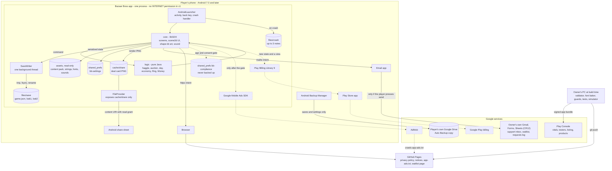
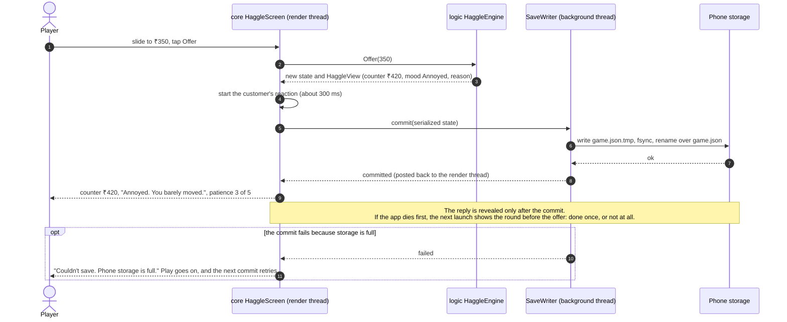
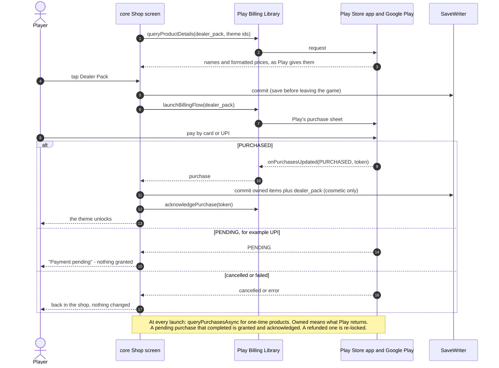
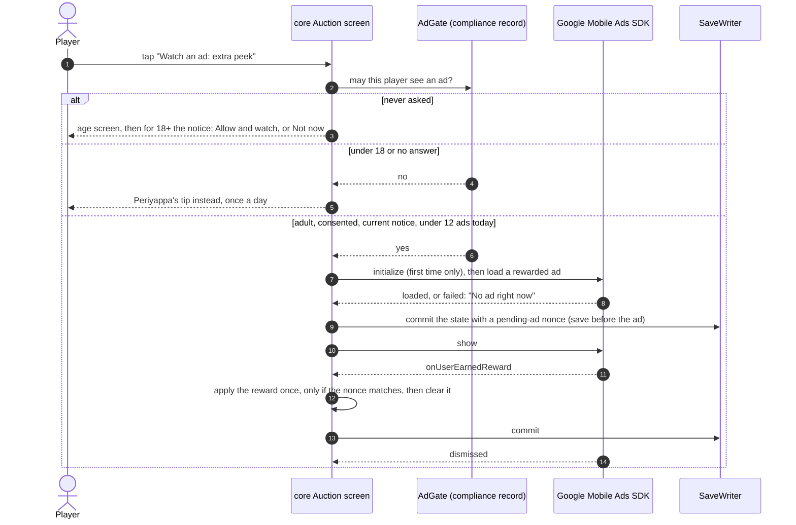

# Bazaar Boss: Haggle Tycoon — Technical Requirements

> **How we build what [PRD.md](PRD.md) describes.** The PRD decides *what* and *why*; this file decides *how*. If a technical fact forces a product change, change the PRD first, then this file.
>
> **Reading the references:**
> - Every choice traces to the PRD — features **F#**, rules **DR#**, compliance **CR#**, open questions **Q#** — or to IDEA.md → Hardening (**H#-#**).
> - **[T#]** marks a source opened on 2026-11-24 (§Sources). "From memory" marks a number nobody checked today. **[A]** marks an assumption or estimate — a guess, said out loud.
>
> **Status (2026-11-24):**
> - **The empty project exists and runs** on the emulator, built and checked from the command line. The commands are in `CLAUDE.md`.
> - No game feature is built. The one-week waitlist test decides whether one will be (PRD §12.1).
> - Nothing in this file costs money.
> - Installing tools is the owner's call. §1.3 lists what's on the PC and what's still missing.

---

## 0. ⭐ The numbers

Every later choice cites these. The user numbers come from the Business verdict in IDEA.md, which labels its own estimates; the arithmetic is shown.

### 0.1 Users

| | Worst | Likely | Best | Arithmetic / source |
|---|---|---|---|---|
| Closed test | 14 testers, ≥ 12 opted in | | | PRD CR17 |
| Installs, launch month | — | **≈ 710** | — | 311 launch burst + 402 that month (Business verdict §2) |
| Installs a month by Nov 2027 | 77 | **402** | 3,232 | Business verdict §2 |
| Installs in year one | ≈ 680 | **≈ 3,600** | ≈ 32,300 | Business verdict §2 |
| Days an install plays, in total | 2.31 | 2.92 | 5.32 | Business verdict §4 |
| Players on a typical day, launch month | — | **≈ 68** | — | 710 × 2.92 ÷ 30.4 |
| Players on a typical day, month 12 | 6 | **39** | 565 | 402 × 2.92 ÷ 30.4 (verdict §4) |
| **We design for** | | **10× likely: ≈ 400–700 players a day** | | §12 says what breaks first |

### 0.2 Requests

| Who calls whom | v1 | With ads (Milestone 4) | With purchases |
|---|---|---|---|
| **The app → a server of ours** | **0.** No server exists (PRD §5) | 0 | 0 |
| **The app → anything on the internet** | **0.** v1 has no internet permission (CR13) | Ad loads. Likely: 39 players × 0.60 views × 1.5 loads per view [A] ≈ **35 a day**. Best: 565 × 1.20 × 1.5 ≈ **1,020 a day** = 0.012 a second | + one purchase query per app start: likely 39 × 2 starts [A] ≈ **80 a day** |
| ↳ busiest minute | 0 | Best case, if 10% of a day's loads fall in one hour [A]: ≈ 1.7 a minute. All to Google, none to us | ≈ 2 a minute, to Google |
| **People → GitHub Pages** (waitlist page, privacy policy) | Likely ≈ 76,000 waitlist views a year (verdict §2) ≈ 208 a day | + a few policy and notice views, and AdMob's crawler for app-ads.txt | — |
| ↳ busiest minute | A post in a 1,000-person WhatsApp group with 10% opening it in the same minute [A]: 100 views ≈ 200 requests ≈ **3.3 a second**, static files | | |
| ↳ bandwidth | 76,000 views × ~100 KB (22 KB page + 77 KB share image) ≈ 7.6 GB a year ≈ **0.63 GB a month**, against GitHub Pages' soft limit of 100 GB a month [T19] | | |

**What follows:** we run no infrastructure. The only request budgets are Google's and GitHub's, and we use under 1% of either.

### 0.3 Data

**On the phone, per install** [A — estimates, measured at M0]

| What | Files | Typical / worst | Arithmetic |
|---|---|---|---|
| The save | `game.json` plus 2 backups | **≈ 15 KB / ≤ 50 KB** each | Godown: 60 items (the Q9 limit) × ~110 B = 6.6 KB. Day state: visits, haggle, today's deals, auction ≈ 4 KB. Records ≈ 1.5 KB. Stats ≈ 0.3 KB. Keys and IDs make up the rest |
| Settings | 1 preferences file | < 1 KB | |
| Crash notes | ≤ 3 files | ≤ 16 KB each | Stack traces are cut at 16 KB |
| Share cache | ≤ 1 PNG | 150–400 KB, deleted at the next launch | A 1080 × 1080 PNG of flat shapes |
| *Later:* age/consent record, ad counter, owned items | 2 preferences files | < 1 KB | |
| **Total** | **≤ 9 files** | **≈ 200 KB, plus the transient PNG** | Under 1% of Android Auto Backup's 25 MB per app [T12] |

**After a year**
- **On any server of ours:** 0 bytes — there is none.
- **In players' own Google Drives:** ≈ 50 KB per player × 3,600 ≈ 180 MB in total. None of it is ours to read (PRD §8.5).
- **In the owner's Google account:**
  - waitlist rows: 63 in a likely test week, ≤ 1,600 at "go" (≈ 130 KB)
  - the requests log: tens of rows
  - support email: tens of messages a month [A]

**App download** [A — measured with Play Console's size report at M0]
- The libGDX native library is ≈ 70–85 KB per CPU type, compressed [T29], and Play delivers one CPU type per phone.
- Fonts baked to images ≈ 0.4 MB: three distance-field atlases, measured in Phase 3 (TD-36). Sound effects ≈ 0.4 MB. Content and strings ≈ 0.5 MB. Code and AndroidX ≈ 2–4 MB.
- **Estimate: 5–10 MB**, against PRD F20's budget of about 50 MB.

### 0.4 Speed

| What | Target | Traces to | How it's met and measured |
|---|---|---|---|
| Tap → the customer starts to react | **p95 ≤ 100 ms** | §3 core loop; F2 | The logic step takes < 1 ms [A]. The save commit takes 5–30 ms on cheap phone storage [A, from memory] and runs while a 300 ms reaction animation plays. Measured with the dev overlay on the 2–3 GB test phone (Q13) |
| Frame time in the haggle, auction and reveal | **p95 ≤ 33 ms** (never below 30 fps); aim for 16.7 ms | F20 AC3 | Shapes are cached as textures, and nothing is allocated per frame (§4.10). Measured on the dev overlay |
| Cold start → first screen | **p95 ≤ 4 s** [A] | F1 AC3 (first offer within 30 s) | A stopwatch on the test phone |
| Loading the save at launch | **≤ 100 ms** [A] | F15 | ≤ 50 KB to parse |
| Commit of a deal, bid, scrap, loan or upgrade | Finishes **before** its result is shown | F15 AC2; §7.10 of the PRD | §3.2 |

### 0.5 How long it may be down

| Part | May it be down? | What the player sees |
|---|---|---|
| **The game** | **Never** — everything it needs is on the phone (F20) | — |
| A bad release | It can't be rolled back on Play: the fix is a new upload plus review, hours to days (from memory) | Hence staged rollouts and the release checklist (§10) |
| Privacy policy page (GitHub Pages) | Hours, rarely | Settings → Privacy policy fails to load in the browser. Old builds link to the same URL forever (§6) |
| *Later:* AdMob | Any time | "No ad right now" — nothing lost (DR32) |
| *Later:* Google Play billing | Any time | "Can't reach Google Play", or "Payment pending" (DR38) |
| Gmail, Forms | Any time | A report waits in the player's email outbox; a waitlist sign-up fails |

### 0.6 What may be stale, and what must never be

| May be stale | By how much | Must never be stale |
|---|---|---|
| *Later:* ad availability | Per request | **The save.** Every committed action is on disk before its result is shown (F15 AC2) |
| *Later:* product names and prices | Fetched when the shop opens | **The ad gate:** adult + consent + current notice version, read at every ad offer (DR30) |
| *Later:* owned items | Until the next successful launch check; refunds re-lock then (DR38) | **The daily ad count**, across clock changes (DR33) |
| Android vitals | About a day (from memory) | **A consent withdrawal** — it takes effect at once (DR34) |
| Share my stats | A snapshot when sent | **The permission allowlist**, checked at every build (CR13) |
| Today's special | One calendar day | — |

---

## 1. The stack

### 1.1 Your defaults, argued

| Default | Verdict | Why it doesn't fit this app |
|---|---|---|
| **Expo (React Native) + TypeScript** | **No** | Expo's three big wins are cloud iOS builds, over-the-air updates, and a managed native layer. The first two are things this product refuses: Android only (PRD §5), and no over-the-air content (§5 Dropped; v1 has no internet permission, CR13).  The game is a continuously animated scene — faces whose brows and mouth carry the mood, the gunny-bag reveal, later dust peeling off. It's drawn "from shapes in code" (IDEA D2) at 60 fps on 2–3 GB phones (F20). React Native would need a GL or Skia view and a JS runtime on top.  And libGDX is already decided [F] (IDEA §6), with the owner's own Java engine to reuse (Q11) |
| **Expo Router** | **No** | There are no URLs or deep links in v1 (§7). Screens are game states with custom back behaviour (F15 AC6), not routes |
| **TanStack Query** | **No** | There is no server state: 0 requests (§0.2) |
| **Supabase** | **No** | No server and no accounts, ever (PRD §5 "Online"; ₹0 running cost). Its free projects also pause after a week without activity, and only 2 can be active [T22] — and a single-player offline game generates no activity |
| **Sentry** | **No** | Crash SDKs are on the PRD's Never list (§8.5). Data safety must say "No data collected" (CR14), and v1 can't reach the internet (CR13). Android vitals plus the opt-in crash note replace it (F19, H5-3). Its free Developer plan is limited to one user [T23]; error quota from memory: 5,000 a month |
| **EAS Build** | **No** | Local Gradle builds are free, unlimited and need no queue. EAS Free gives 15 Android builds a month on a low-priority queue [T24], and iOS isn't planned |
| **EAS Update** | **No** | Over-the-air code is the exact risk Hardening dropped (H1-3): a hijacked account could push anything to every player overnight. It also needs the internet. Its free tier covers updates to 1,000 monthly users [T24] |
| **RevenueCat** (your tool list) | **No** | Its price isn't the problem: free up to $2,500 a month in tracked revenue, then 1% [T25]. The problem is a third company receiving purchase data and an app user ID — a new row in the data table — to manage two cosmetic products. Play Billing directly is enough (§9) |

**What would change my mind:** wanting iOS built from Windows (Expo), cross-device accounts (Supabase), or live content (EAS Update). Each of those is a PRD change first.

**The close alternative, and the tiebreaker.** Native Android — Kotlin with Jetpack Compose and Canvas — is the strongest alternative, and in two ways it beats libGDX:
- It shapes Tamil and Devanagari script for free — Q10's native-script menus would cost almost nothing.
- Android's screen reader (TalkBack) can read a Compose UI; it can't read a libGDX game screen.

**Tiebreaker:** libGDX is already decided [F]; the owner's engine is Java and libGDX (Q11); and libGDX's desktop window runs the whole game on the PC for fast iteration and the haggle lab. **It would flip if** Q10 becomes "yes" or screen-reader support becomes a requirement (§11, decision 1).

**Also considered:**
- **Godot 4:** editor-based, its own scripting language; can't reuse the owner's Java.
- **Flutter + Flame:** Dart; good UI; same reuse problem.
- **Unity:** heavier runtime, and licensing churn (from memory).

All three lose on reuse, and on a decision already made.

### 1.2 What we use

Every row costs **₹0 at 1,000 players**: nothing here charges per player.

| Layer | Choice and version (2026-11-24) | Why — traces to | Free-tier limit, and what happens past it |
|---|---|---|---|
| Engine | **libGDX 1.14.2**, the latest release (2026-06-05) [T1][T2]. Since 1.13.0 it supports Android's predictive back [T4], but its callback asks for no frame, so the game routes back itself (TD-35); and since 1.13.5 its minimum Android is 21 [T4]; its Android libraries are aligned for 16 KB memory pages (RESEARCH S27) | IDEA §6 [F]; CR9; F15 AC6; F20 | Apache-2.0 — no limits |
| Project layout | **Written by hand from gdx-liftoff's template** (v1.14.2.4 [T3]). Same shape: `core`, `android`, `lwjgl3`, plus libGDX's native-library unpacking step | Liftoff only runs as a click-through window app; it has no command-line mode [T33]. The hand-written build runs entirely from the command line and is checked into git (TD-21) | Free |
| Gradle | **8.14.8**, through the Gradle wrapper, with the download's SHA-256 pinned in `gradle-wrapper.properties` | The newest 8.x release (2026-11-19) [T30]; AGP 8.13 needs Gradle 8.13 or newer [T8]. With the wrapper, nobody installs Gradle by hand; the checksum blocks a tampered download | Free |
| Language | **Java**, compiled for Java 8 (`--release 8`) in every module that ships | One language for the game, the logic, the simulator and the tests; the owner's engine is Java (Q11). `--release 8` stops code from calling Java 9+ APIs that Android 7 doesn't have — crash-safety on the oldest supported phones (F20 AC6). It doesn't stop Java 8 APIs that Android 7 lacks (`java.nio.file`, `String.join` and others); the Android 7 API test does (§4.11). Cheap to raise later | — |
| Build JDK | **JDK 17 or newer** [T5][T8]. Verified on the owner's PC with Oracle JDK 17.0.11, the `java` on PATH. Android Studio's bundled JDK 21.0.9 is also there (TD-22) | Gradle 8.10+ and the Android plugin need JDK 17 or newer [T5][T8]. Liftoff's "21 recommended" is a preference, not a requirement | Free |
| Android Gradle plugin (AGP) | **8.13.2** — maximum API level 36.1; needs Gradle 8.13 and JDK 17 [T8] | **Liftoff's default is 8.9.3 [T6], and AGP 8.9 supports API 35 at most [T7].** Play has required API 36 since 31 Aug 2026 [T10]. AGP 9.5 (Oct 2026, up to API 37 [T9]) is a major version that libGDX's templates haven't adopted — TD-08 | Free |
| SDK levels | **compileSdk 36 · targetSdk 36 · minSdk 24** | target: Play's requirement [T10], CR9. min: PRD F20 (Android 7.0); also exactly what the ads SDK needs from 25.5.0 [T17]; liftoff's default is 21 [T3] | — |
| UI | scene2d.ui (part of libGDX), with **styles built in code** — no Skin JSON | Skin JSON is loaded by reflection, which release-build code shrinking can break. Building in code also matches D2 | — |
| Art | ShapeRenderer and polygon sprites drawing from the face and item "kits"; each customer is drawn once into a texture | IDEA D2; F20 (smooth on 2–3 GB phones) | — |
| Fonts and icons | **Roboto** 400/500 (Android's own face) for the UI, and **Rozha One** for what characters say. Both are SIL OFL, from Google Fonts. They're baked at build time into distance-field atlases, one per face, which draw every size of DESIGN.md's type scale at every text-size step (S, M, L, XL) and density (TD-36). **The files are pinned** (Phase 3): Roboto 400 and 500 as the static files the Google Fonts API serves (v51), and Rozha One from `github.com/google/fonts`. Their SHA-256s are in BUILD-PLAN Phase 3, and the baker checks them. **The character set:** Latin, ₹, curly quotes, …, the en dash and the minus sign. **Material Symbols** (Apache-2.0): only the glyphs we use, baked into an atlas. **Replaces Noto Sans** (TD-26) | DESIGN.md §2.2, §2.5; L-11 (no FreeType at runtime); F13 AC3; CR6 | — |
| Sound | Sound effects made with jsfxr (the owner's own) or CC0, as OGG, played by libGDX `Sound` | F14, CR6 | — |
| Content | CSV and JSON in git → a build-time validator → JSON assets (§4.4) | IDEA D3; F13 AC1; DR24 | — |
| Android library | **AndroidX Core 1.17.0** — libGDX's Android backend already brings it in (verified 2026-11-24). We'll also use its FileProvider. It adds one app-private permission (TD-24) | F12, F18 — sharing without any storage permission | Apache-2.0 |
| Tests | **JUnit 5.14.4**, the newest 5.x [T31] — used only in tests, never shipped. JUnit 6 exists but needs Java 17 | Unit tests, migration tests, guards | EPL-2.0, test-only (L-11) |
| Simulator | A plain Java program in the `sim` module, running the real `logic` | DR11, F11 AC4, Check 3 | — |
| Desktop dev window | libGDX's LWJGL3 desktop backend — for development only, never shipped | Fast iteration on Windows; the haggle lab | — |
| Source control | The existing private GitHub repo | — | Free |
| CI | **None hosted in v1.** A versioned pre-push hook, `.githooks/pre-push`, runs `./gradlew check :android:assembleDebug` on every push; it's switched on once per clone with `git config core.hooksPath .githooks` (LLD §8) | The guards run inside the Gradle build itself, so they hold on any machine. GitHub Actions is optional later; its free allowance for private repos is now counted in money, not minutes — check it before relying on it [T21] | — |
| Web hosting | **GitHub Pages** (rameshkumark24.github.io): the privacy policy, notice pages, app-ads.txt and the waitlist page | CR15, CR21, CR25; already owned | Site ≤ 1 GB; **100 GB a month bandwidth (soft)**; 10 builds an hour (soft); deploys time out after 10 minutes [T19]. Past a soft limit, GitHub may ask us to reduce use. **Not for e-commerce or commercial transactions** [T19] — policy and notice pages are fine |
| Distribution | **Google Play** (personal account, already paid) | IDEA §9 | $25, already paid |
| Crash data | **Android vitals** in Play Console | H5-3 | Free |
| Waitlist, support, requests log | Google Forms, Gmail, Sheets — on the owner's own Google account (PRD CR12, decided 2026-11-25; it was the game's own account) | H2-10, H2-11 | **Gmail: more than 500 recipients in one email, or more than 500 emails in a day, hits the sending limit** [T20] — see §12 |
| *Later:* ads | Google Mobile Ads SDK: Legacy **25.5.0** (2026-09-17, minimum Android API 24) [T17], or the Next-Gen SDK [T18] — chosen at Milestone 4 (TD-16) | Milestone 4; CR19–CR27 | Free; it earns. AdMob pays out at $100 (Business verdict B15) |
| *Later:* purchases | **Play Billing Library 9.x** — 9.1.0 is the latest (2026-06-18) [T14]. Version 8 is deprecated for new apps and updates from 31 Aug 2027 [T15] | CR29; purchases ship right after G3, ≈ May 2027 at the earliest (PRD Q19) | 15% service fee on purchases (RESEARCH L-7) |
| *Later:* notifications | Android's AlarmManager, scheduled on the phone — no push service | DR39, H1-9 | Free |

### 1.3 Platforms, and the machine you have

**v1 ships on Android only** (PRD §5: iOS isn't planned). Everything below runs on the owner's Windows 11 PC.

| Step | How |
|---|---|
| **Already on the owner's PC** (checked 2026-11-24) | • Android Studio 2025.3, with its bundled JDK 21.0.9 • Oracle JDK 17.0.11, on PATH • Android SDK: platforms 35, 36, 36.1; Build-Tools 34–36.1; platform-tools (adb); emulator 36.4.10, using Windows' hypervisor (WHPX), which reports "installed and usable" • Two virtual devices: **Medium_Phone_API_36.1** (Google Play image) and **LowEnd_A9** (API 28) |
| **Downloaded for the empty project**, with the owner's yes | Gradle 8.14.8, and the build's dependencies: AGP 8.13.2, libGDX 1.14.2, JUnit 5.14.4. Nothing was installed system-wide |
| **Create** | Written by hand (TD-21). Every command that works is in `CLAUDE.md` → Commands |
| **Run while building** | `gradlew lwjgl3:run` — the whole game in a desktop window; the fastest loop. *Not run yet* |
| **Run on a phone** | USB debugging on, then `gradlew android:installDebug` or Run in Android Studio. *Not verified yet* — it needs the owner's phone (Q13) |
| **Run on emulators** | **Verified:** Medium_Phone_API_36.1, started from the command line (CLAUDE.md). Present but not yet used: LowEnd_A9 (API 28). **Not verified: API 24**, the oldest Android we support — this PC has no API 24 system image. Downloading one needs the owner's yes; do it before the closed test (TD-23) |
| **Test** | • `gradlew check`: compiler lint, Android Lint, unit tests — and, as they arrive, migration fixtures, the content validator and the manifest and backup-rule guards • Screen states for screenshots: save files from `logic/src/test/resources/fixtures/screens/`, installed on a debug build through `run-as` (LLD §7.3; the commands join CLAUDE.md once spike U8 passes) • `gradlew sim:run`: the simulator report (the module arrives with its first code) • A screenshot to prove any screen: `adb exec-out screencap -p > shots/<name>.png` (CLAUDE.md) • Maestro, to tap through screens: later, with the owner's yes, once there are screens (decided 2026-11-24) • The PRD's acceptance criteria, by hand, on the phone at each milestone |
| **Ship** | `gradlew android:bundleRelease` → an Android App Bundle (AAB) signed with the upload key → Play Console: internal testing → closed testing (14 days) → production, as a staged rollout. **Not run yet.** Still missing: • the upload key — the owner creates it with the JDK's `keytool`, and it stays outside git (CR11) • a signing config that reads the key from a file outside git • code-shrinking (R8) rules • the Play Console app entry and its forms: privacy policy URL (CR15), Data safety, target audience, content rating • the store listing's images  No Mac and no paid plan are needed |
| **iOS** | **Not possible from this machine.** libGDX's iOS route needs a Mac with Xcode (from memory). Apple's $99 a year is pre-approved only if iOS ships, and it isn't planned |

---

## 2. The shape

### 2.1 Where each thing runs

| On the phone | On Google's servers (the owner configures them) | On GitHub Pages | On the owner's PC, at build time |
|---|---|---|---|
| **The whole game:** • rules, content and saves • settings and crash notes • sharing, reports, the privacy link • *later:* the age gate, consent, ad cap and owned items | • Android vitals; Play review; the closed-test tester list • *later:* AdMob's console rules • *later:* the product list and prices in Play Console; whether a purchase is paid | Static pages only: the privacy policy, notices, app-ads.txt, the waitlist page | • the content validator, font baking • the manifest and backup-rule guards • tests and the simulator • signing the release |

**There is no server of ours, and none is added** (H4). Anything ever shared between players needs a server and a redesign first (H4-19).

### 2.2 What the phone must never decide

Hardening's rule of thumb (H4) applies. If getting around a rule only changes the cheater's own single-player game, the rule lives on the phone. If it touches money, children, the law or other people, it lives with Google wherever Google offers that — otherwise it's an accepted risk (H5).

| Rule | Who decides | Why the phone can't | Traces to |
|---|---|---|---|
| The real-money price of anything | Google Play — the product's price as Play formats it | A modified app could show any number | DR37, CR31 |
| Which products exist | Play Console's product list | A product missing there can't be bought at all | CR31, H4-8 |
| Whether a payment has cleared | Play Billing's purchase state. PENDING never grants anything | — | DR38 |
| Which ad categories and ratings may show | AdMob's console (and also the code) | A modified app could strip the code setting | CR23, H1-7 |
| Whether the app may use the network, or any permission | The build: the allowlist guard (§4.11), and Android itself | Android blocks network use without the permission | CR13, H4-1 |
| Whether a build contains real ad IDs | The build: only the release variant gets them, and they're kept out of git. Play's tester tracks get release builds, so at M4 testers' phones are registered as AdMob test devices (TD-32) | — | CR18, CR24, H4-4 |
| What the privacy policy says | The data table (PRD §8.5), written by the owner | — | CR15 |

**What the phone does decide, knowingly** (accepted risks):
- in-game cash, prices, limits, timers and saves (H5-1)
- the age gate and the consent record (H5-6, H5-7)
- the purchase check, for cracked apps (H5-11)

### 2.3 The modules

| Module | What it is | May depend on | Ships? |
|---|---|---|---|
| `logic` | **Pure Java.** The model, the commands (§5.2), the haggle, auction, day and economy rules, `Rng`, `Money`, `IndianNumberFormat`, the `Clock` interface, the save codec and its migrations, and the content model | **Only** libGDX's pure-Java JSON utilities (`com.badlogic.gdx.utils.Json*`). A unit test fails the build if `logic` imports anything else from libGDX | Yes |
| `core` | The libGDX game: screens, scene2d UI, shape kits, sound, `BackDispatcher`, `SaveWriter`, and the `PlatformServices` interface | `logic`, libGDX | Yes |
| `android` | `AndroidLauncher`, the `PlatformServices` implementation (share, email, browser, cache folder, versions), FileProvider, the manifest, the backup rules, the crash handler. *Later:* the ads and billing adapters | `core`, AndroidX Core | Yes |
| `lwjgl3` | The desktop launcher, with a stub `PlatformServices` that logs instead of sharing | `core`, `devtools` | No — development only |
| `devtools` | The dev menu, the haggle lab, the text test and the screen-fixture loader | `core` | No — plugged in only by `android/src/debug` and `lwjgl3`, so release builds can't contain it (PRD §6; LLD L-1) |
| `sim` | The simulator and haggle-lab batch runs; writes CSV reports | `logic` | No |
| `tools` | The content validator and builder, and the font baker (FreeType runs here, at build time only) | libGDX, gdx-freetype (desktop) | No |

**Package:** `io.github.rameshkumark24.bazaarboss.*` — the same as the permanent app ID (§11).

**Planned (LLD L-2, the vertical-slice phase):** `core`'s code moves under `io.github.rameshkumark24.bazaarboss.core.*` (today `BazaarBossGame` sits in the root package), and an `assets/` folder is added and wired into `android` and `lwjgl3` the way liftoff's template does it. Packages inside `logic` and `core` are split by feature (LLD §1).

**As built (2026-11-24):**
- The empty project has `logic`, `core`, `android` and `lwjgl3`.
- `sim` and `tools` are created with their first code.
- `core` draws a single "empty project" label, which M0 replaces.

---

## 3. The components

### 3.1 Every part, and what calls what

Dashed parts arrive later: purchases right after G3, and ads at Milestone 4 only if installs pass about 3,000 a month (PRD Q19). Here is what the template's boxes become in this app:
- **The API and the database:** there are none. The "API" is the in-process logic API (§5.2), and the "database" is files on the phone.
- **Cache:** `cache/share/`.
- **Background jobs:** the SaveWriter thread, plus Android's own Backup Manager.
- **Push:** none, ever. Notifications are scheduled on the phone (DR39).

### 3.2 The core loop — one haggle round

### 3.3 Payment (purchases, right after G3: ≈ May 2027 at the earliest)

### 3.4 Rewarded ad (Milestone 4, only if installs pass about 3,000 a month)

### 3.5 What runs while the player waits, and what runs in the background

| While the player waits | Why |
|---|---|
| One logic step (well under 1 ms [A]) | The game is the logic |
| The save commit, hidden under a reaction animation | Exactly-once: the result shows only after the commit (PRD §7.10) |
| Loading the content pack and the save at launch (≤ 1–2 s on a cheap phone [A]) | Resume exactly where the player left off (F15) |
| *Later:* product details when the shop opens; an ad load after the tap | Prices come from Play (DR37). Ads load only when the player wants one — no ad requests otherwise |

| In the background | Run by | Why it's not in the foreground |
|---|---|---|
| Writing the save file | The SaveWriter thread: a single thread, so commits stay in order | File writes and fsync must never block a frame (F20) |
| Rotating the backups (at each day end, and after a load that found something new) | The SaveWriter thread | Day-level checkpoints are what PRD F15 AC3 restores from |
| Cleaning the share cache | At launch, on the SaveWriter thread | Temporary files never pile up |
| The Auto Backup to Drive | **Android itself:** every 24+ hours, when the phone is idle, on Wi-Fi (unless the player opted otherwise) [T12] | It's Android's job; we only supply the rules (§4.11) |
| *Later:* local notification alarms | AlarmManager | DR39 |
| **No queue, no scheduled job, no webhook** | — | No server exists. Play's real-time purchase notifications need a server, so we don't use them (H5-11) |

---

## 4. The data model

### 4.1 The shape: local-first documents

| Store | What | Why this shape |
|---|---|---|
| **The save document** | One versioned JSON document per game: `game.json` plus two backups | **One player, one phone, no sync.** The whole state is ≤ 50 KB (§0.3). Writing the whole document atomically for every action gives exactly-once for free (PRD §7.10): the file is either the old state or the new one, never half of each |
| **The content pack** | Read-only JSON shipped inside the app | Content ships only in app updates (H1-3) |
| **Two key-value stores** | Settings; *later* the compliance record (never backed up) and owned items | Small, independent of the game's progress, with different backup rules (H1-10) |
| **Crash notes** | Up to 3 text files | F19 |

**Rejected:**
- **SQLite / Room:** relational power we'd never use — no joins and no queries beyond in-memory filters (§4.9). It adds Android-only code, and the desktop simulator must run the same rules (DR11).
- **An event log:** exactly-once is already guaranteed by atomic commits. A log also grows forever, the opposite of "data per user" staying flat (§0.3), and migrating events is harder than migrating one document.
- **Preferences for the save:** many keys can't change together atomically.

### 4.2 Types for anything a human counts

| What | Type | Never |
|---|---|---|
| **Money** | `long`, in **whole rupees** — ₹1 = 1. There are no paise anywhere [A]. Arithmetic uses `Math.addExact` / `multiplyExact`, so an overflow is a loud bug, not a wrong number | `float`, `double`, formatted strings |
| Percentages, shares, chances | `int` in **basis points**: 1 bp = 0.01%, so −10% = 1,000 bp and a 25% fake chance = 2,500 | Floats |
| Price rounding | `Money.applyBp()` with half-up rounding, then `Money.toBazaarStep()`. The step table lives in content [A] — e.g. ≥ ₹100 rounds to ₹5, ≥ ₹1,000 rounds to ₹10 | Ad-hoc rounding |
| In-game time | `int dayNumber` (starts at 1), `int round` | — |
| A moment in real time | `long` epoch milliseconds, UTC, from the injected `Clock` | Naive date strings |
| A calendar day | `long localEpochDay` = `floorDiv(utcMs + zoneOffsetMs, 86_400_000)`, using the phone's time zone at that moment | `java.time` — missing on Android 7.x without desugaring |
| Durations (play time, auction countdown) | `long` milliseconds from a **monotonic** clock (`System.nanoTime()`), counted only while the game is in the foreground | `Gdx.graphics.getDeltaTime()` — a float |
| IDs in content | `String` matching `^[a-z][a-z0-9_]{1,39}$`. **Permanent**: never renamed, reused or deleted — retired content gets `hidden: true` (§6) | — |
| IDs of instances in a save | `long` from the save's `nextId` counter: monotonic, unique within the save, never reused | Random UUIDs — they'd be identifiers we don't need |
| Enums | Their stable lowercase names as strings | Ordinal numbers |
| JSON numbers | Integers only. libGDX's JsonReader parses integers with `Long.parseLong`, without a detour through `double` [T28] | Decimal points in a save |
| Text made from numbers and dates | Our own `IndianNumberFormat`, and one fixed English date format. Any `String.format`, `toLowerCase` or `toUpperCase` takes `Locale.ROOT`. A test runs them under `mr-IN`, `bn-IN`, `ur-IN`, `ar-EG` and `tr-TR` (TD-29) | The phone's locale: it gives digits the font can't draw, and Turkish lowercasing breaks enum names |

### 4.3 Determinism

The simulator must predict the phone (Check 3, DR11), so the logic gives the same result on every machine:
- **Integer arithmetic only** (§4.2).
- **Our own random-number generator** (xoroshiro128\*\*, about 20 lines, public-domain algorithm). Its 2-long state is stored in the save. It's seeded once per new game from `SecureRandom`; the simulator seeds it explicitly.
- **No `HashMap` or `HashSet` iteration** in the logic. Iteration order can differ between Android's runtime and the desktop JDK. Use sorted lists or `TreeMap` when iterating; hash maps are only for lookups.
- **No wall clock inside the logic.** Time comes from the `Clock` interface, so tests and the simulator can fake it.

### 4.4 The content pack (read-only)

**Pipeline:**
1. The sources live in git: `content/strings.csv` (columns `id | en | tanglish | hinglish | max_len | note` — IDEA D3), `content/*.json` (items, customers and so on), and `content/banned/*.txt`.
2. `tools:validateContent` checks them, as part of `check` and before every release bundle (§4.11).
3. `tools:buildContent` writes `assets/content/pack.json` and `assets/strings/{en,tanglish,hinglish}.json`.
4. At runtime, only the chosen voice plus English (the fallback) are loaded (§12).

| Entity | Fields — type — empty? | Notes |
|---|---|---|
| `ContentPack` | `contentVersion` int · `categories`, `items`, `personalities`, `customerTypes`, `regulars`, `rivals`, `tiers`, `teasers`, `specials` — lists, never empty · `market` MarketDef · `bazaarSteps` list of {from long, step long} | List order is the canonical order |
| `CategoryDef` | `id` · `nameLineId` String | About 6 in v1 |
| `ItemDef` | `id` · `categoryId` · `nameLineId` · `baseValue` long ₹ · `scrapValue` long ₹ · `rarity` enum common/uncommon/rare · `fakeChanceBp` int 0–10,000 · `conditionMin`/`conditionMax` int 1–5 [A] · `clues` list of ClueDef (2–3) · `artKit` String · `hidden` bool (default false) | 40 in v1 (F4) |
| `ClueDef` | `id` · `kind` enum weight/marks/wear · `genuineLineId` · `fakeLineId` String | Clues never lie (DR21). What inspecting costs is Q4 |
| `PersonalityDef` | `id` (tough_bargainer, emotional_seller, rushed_buyer, collector, con_artist) · `punishes` enum · `patienceStart` int · `params` map of String → int (bp or counts), iterated in sorted order | DR11 |
| `CustomerTypeDef` | `id` · `personalityId` · `faceKit` String · `buys` bool · `sells` bool · `favouriteCategoryIds` list (may be empty) · `lineSets` map of situation → list of lineIds | 8 in v1 |
| `RegularDef` | `id` · `customerTypeId` · `memoryLineIds` list | 2–3 in v1 |
| `RivalDef` | `id` · `nameLineId` · `budgetMin`/`budgetMax` long ₹ · `riskBp` int · `favouriteCategoryIds` list · `faceKit` | 2 per auction in v1 |
| `TierDef` | `id` (stall/shop/showroom/gallery) · `goalTarget` long ₹ · `displaySlots` int · `reachableInV1` bool | Q6, Q7 |
| `MarketDef` | `id` (coimbatore) · `itemIds`, `customerTypeIds` lists · `peekMs` int = 10,000 · `rivalsPerAuction` int = 2 · `auctionsPerDay` int = 1 · `customersPerDayMin`/`Max` int · `godownLimit` int [A: 60, Q9] | F5, F6 |
| `TeaserDef` / `SpecialDef` | `id` · `lineId` · `effect` (a typed spec) | DR27, DR26 |
| String row (per voice) | `id` → text, with `{placeholders}` | Validated: present in all three voices, the same placeholders in each, ≤ `max_len`, no banned word, **every character in the baked font**. That last check prevents missing-glyph boxes |

### 4.5 The save document — `files/save/game.json`

**File format:**
- Line 1 is a header: `BBSAVE <crc32-hex> <byteLength>`.
- Line 2 is the JSON.
- The header lets the loader reject a damaged file before parsing it.
- **Explicit keys, no reflection.** The codec reads with `JsonReader`/`JsonValue` and writes with `JsonWriter`, every key a string literal. Never libGDX's reflection-based `Json`: release builds' R8 renames fields, and renaming a field in code would change the file. The content pack (§4.4) is read the same way. Migration fixtures compare values, not just "it parsed" (TD-27).

| Entity | Fields — type — empty? | Notes |
|---|---|---|
| **GameState** (root) | `formatVersion` int, from 1 · `writtenBy` int — the app versionCode · `contentVersion` int · `createdAtUtcMs` long · `nextId` long, from 1 · `rng` long[2] · `player` PlayerState · `godown` list of OwnedItem (may be empty) · `day` DayState · `records` Records · `stats` Stats · `hintsSeen` sorted list of String (may be empty) · `owed` list of OwedResult, at most one of each kind: deal, auction, Lesson, tier-up (LLD L-5; EDGE-CASES LC-3) | The only root. **No owner field — see §4.7** |
| **PlayerState** | `cash` long ≥ 0 (DR2) · `reputation` int 0–100 [A] · `tierId` String · `dayNumber` int ≥ 1 · `goalProgress` long ₹ — profit earned since the last tier. It only rises, and starts at 20% of the target (Periyappa's gift). Q6, decided 2026-11-24 (PRD F7) · `loan` Loan or **null** · `periyappaGiftGiven` bool | |
| **Loan** | `principal` long > 0 · `repaid` long, from 0 to principal · `repayShareBp` int 1–10,000 · `takenOnDay` int | One at a time (DR3). It's set to null when fully repaid |
| **OwnedItem** | `id` long · `itemDefId` · `condition` int · `fake` bool · `cluesSeen` sorted list of clue IDs (may be empty) · `paid` long ≥ 0 (0 for a gift) · `acquiredDay` int · `displaySlot` int or **null** (null = in the godown) · `reservedByVisit` long or **null** | Reserved while a buyer is haggling for it, so it can't be sold twice (§7.10 of the PRD) |
| **DayState** | `phase` enum morning/trading/evening · `auction` Auction or **null** · `reveal` Reveal or **null** · `visits` list of Visit (may be empty) · `haggle` Haggle or **null** · `deals` list of DealRecord — today's only (may be empty) · `bohniDone` bool (if Q8 is accepted) · `specialId` String or **null** · `pendingAd` {nonce long, offer enum} or **null** (Milestone 4) | Cleared at the day end, after the kanakku is committed |
| **Visit** | `id` long · `customerTypeId` · `regularId` String or **null** · `direction` enum buys/sells · `wantsItemId` long or **null** (buys: an item on display) · `brings` OfferedItem or **null** (sells) · **`walkAway` long ₹** · `openingPrice` long · `patience` int ≥ 0 · `mood` int −100–100 [A] · `status` enum waiting/haggling/done/left · `calledBack` bool | `walkAway` is fixed when the visit is made (DR6). It never leaves `logic` except as the verdict (DR7, §5.2) |
| **OfferedItem** | `itemDefId` · `condition` int · `fake` bool · `cluesSeen` sorted list (may be empty) | Becomes an OwnedItem, with a new `id`, when bought or kept |
| **Haggle** | `visitId` long · `round` int ≥ 0 · `offers` list of Offer (may be empty) · `lastPriceUsed` bool · `inspectTaps` int (if Q4 is accepted) | At most one at a time |
| **Offer** | `by` enum player/customer · `price` long · `moodAfter` int · `reasonId` String (a line ID) | The history shown with reasons (F2 AC2) |
| **DealRecord** | `seq` long (from `nextId`) · `visitId` long · `itemDefId` · `direction` · `price` long · `costBasis` long · `profit` long or **null** (null when the player bought) · `reputationDelta` int · `walkAway` long (for the verdict) · `day` int | Copies the item's content ID rather than pointing at the item instance, so nothing dangles after the item is gone |
| **Auction** | `lotSeq` long · `lot` list of OfferedItem — **fixed at creation (DR15)** · `peekIndices` sorted list of int · `rivals` list of RivalState · `currentBid` long · `leader` String (none / player / a rival ID) · `peekRemainingMs` long · `countdownMs` long · `status` enum peek/bidding/sold/skipped/left | Committed at every bid, because bids are final (DR17) |
| **RivalState** | `rivalDefId` · `budget` long · `estimate` long (fixed at the peek, shown after the hammer — DR19) · `out` bool | Rivals see only `peekIndices` (DR16) |
| **Reveal** | `lotSeq` long · `nextIndex` int · `decisions` list of enum keep/scrap, or null for undecided | Interrupted reveals resume here (F5) |
| **Records** | `bestDealEver` DealRecord or **null** · `discovered` sorted list of itemDefIds (may be empty) · `regulars` a sorted map of regularId → RegularMemory · `lastSpecialEpochDay` long (−1 = never) · `maxEpochDaySeen` long (the clock-back guard) · `lastWelcomeBackEpochDay` long · `pendingTeaserId` String or **null** | |
| **RegularMemory** | `itemDefId` · `price` long · `soldFake` bool · `day` int | F3 AC2 |
| **Stats** | `firstPlayedEpochDay` long · `lastPlayedEpochDay` long · `daysPlayed` int · `gameDaysStarted` int · `gameDaysFinished` int · `haggles` int · `deals` int · `playTimeMs` long · `playTimeToShopMs` long or **null** | Exactly what Share my stats needs (F18, §12.2 of the PRD) |

### 4.6 The device's other stores

| Store | Where | Fields | Backed up? |
|---|---|---|---|
| Settings | libGDX Preferences `bb-settings` → Android SharedPreferences [T27] | `voice` enum en/tanglish/hinglish · `voiceChosen` bool · `soundOn` bool · `vibrationOn` bool · `textSize` enum s/m/l | **Yes** (H1-10) |
| Crash notes | `files/crash/crash-1…3.txt` | Time (UTC ms), versionCode, save formatVersion, Android SDK level, stack trace ≤ 16 KB. No IDs, no device model | **No** |
| Share cache | `cache/share/deal-card.png` | The last deal card | No — Android never backs up the cache folder [T12] |
| *M4:* compliance | Preferences `bb-compliance` | `ageStatus` enum unknown/adult/minor · `ageAskedAtUtcMs` long or null · `consent` enum allowed/declined/withdrawn, or null · `consentAtUtcMs` long or null · `noticeVersion` int or null · `minorRecheckAtUtcMs` long or null · `adsShownToday` int · `adsCountEpochDay` long · `maxEpochDaySeen` long | **Never** (H1-10, H4-13) |
| *Purchases:* owned items | Preferences `bb-entitlements` | `owned` a sorted set of product IDs · `lastVerifiedUtcMs` long | Yes — harmless, since it's re-checked with Play at every launch |

### 4.7 ⭐ Ownership — who owns each record, and what proves it

| Data | Owner | What proves ownership | How it's enforced, in this store |
|---|---|---|---|
| The save, settings, crash notes, the compliance record, owned items | **The one player of this install** | **No field does, deliberately.** A field can't prove anything on a phone the player controls. The proof is *where the file lives*: the app's private storage, under Android's per-app Linux user ID (libGDX's "local" files are Android internal storage [T26]) | **Android's app sandbox:** • files are private to the app • no component is exported except the launcher activity, and AndroidX's `ProfileInstallReceiver`, which only callers holding the system's `DUMP` permission can reach (verified 2026-11-25, TD-30) • the FileProvider exposes `cache/share/` only • the backup rules list what may leave (§4.11) |
| The content pack | The developer | The signature on the app bundle (Play App Signing) | Assets are read-only. A tampered app only changes the tamperer's own game (H5-1) |
| Waitlist rows, the requests log, the support inbox | The owner's own Google account (PRD CR12) | Access to that account | Google's access controls. 2-step verification (CR11). Sheets are private — never "anyone with the link" |
| Testers' email addresses | The owner's Play Console | Console access | Google's access controls, with 2-step verification |
| *Later:* ad data | Google (AdMob), for consenting adults | — | The ad gate (DR30); data flows as listed in the PRD's data table |
| *Later:* orders | Google Play | — | Play Console. The app keeps only the owned product IDs |

**⚠ Flags — the places a leak would come from, with the rule that closes each:**
1. **FileProvider paths.** `res/xml/share_paths.xml` declares only `<cache-path name="share" path="share/"/>`. Exposing `files/` would let the share sheet reach the save. Guarded by a unit test.
2. **Two sets of backup rules.** Android 12+ reads `dataExtractionRules`; Android 11 and older read `fullBackupContent`. Forgetting one would back up the compliance record on some phones. Both are checked (§4.11). Inside `dataExtractionRules`, `<cloud-backup>` and `<device-transfer>` are separate sections: without the second, a phone-to-phone transfer copies everything, and `allowBackup` doesn't stop it (TD-30).
3. **The Google Form's "view results summary" setting** must be off. If it's on, respondents can see other people's answers, including their emails. This is on the owner's form checklist (site/README.md).
4. **The report email is built field by field** (§5.3). Never "attach the save" or "dump the state".
5. **Release builds don't log.** The log facade is a no-op in release, and the crash note holds stack traces only.
6. **No WebView.** The policy opens in the player's browser, so there's no in-app web content and no JavaScript bridge.
7. **The crash handler passes the crash on to Android's own handler.** Otherwise Android vitals would never see the crash.

### 4.8 What happens on delete, for every relationship

| When… | …then | Why |
|---|---|---|
| **Start over** (F17) | Delete `save/`, `crash/`, `cache/share/` and the `bb-settings` preferences; *later*, `bb-compliance` too. Owned purchases are **not** deleted: they're Google's records and come back at the next launch check | F17 AC2; PRD §7.9 |
| An owned item is sold or scrapped | It's removed from the godown. Its `displaySlot` is freed. A `reservedByVisit` blocks the sale until that haggle ends, so no other customer can buy it meanwhile | Never sold twice |
| A visit ends | `reservedByVisit` on its item is cleared. The `haggle` becomes null | — |
| The day ends | `deals` feed `bestDealEver`, then are cleared. `visits`, `auction`, `reveal` and `haggle` are cleared. The backups rotate | §3.5 |
| A deal record outlives its item | Fine: it holds the content ID, not the instance | — |
| The loan is repaid | `loan` becomes null | DR3 |
| A content item is retired in an update | It's marked `hidden: true` and stays in the pack forever. Saves that reference it still load (§6) | The old-build rule |
| A regular's memory | Keyed by the permanent `regularId`, and kept for the life of the save | F3 |
| Uninstall | Android deletes everything on the phone. The Drive backup follows Android's own retention (from memory) | H5-2 |

### 4.9 The queries this app actually runs

| Query | When | What makes it fast | Stable order |
|---|---|---|---|
| Load and parse the save | At launch | ≤ 50 KB (§0.3) | — |
| Godown: filter by category, sort by price paid / condition / newest | The godown screen | n ≤ 60 (the Q9 limit), held in memory | **Key, then `id`** — unique and monotonic, so ties always break the same way |
| Items on display | Every stall frame | Kept as an array indexed by slot | By slot number |
| Today's deals | The kanakku | ≤ 8 a day | By `seq` |
| Best deal of the day / ever | The kanakku, and every sale | One comparison per sale | Highest profit, then lowest `seq` |
| Found counter | The stall and the godown | `discovered.size()` | Sorted by ID |
| A regular's memory | When a regular arrives | TreeMap lookup | — |
| Is Today's special available? | The stall | `today > lastSpecialEpochDay`. If `today < lastSpecialEpochDay − 2`, it's a clock correction: reset to today and offer it (DR26) | — |
| Content by ID | Everywhere | HashMaps built once at load, for lookups only | Iterate in the pack's list order |
| Share my stats | On tap | Read straight from `Stats` | Fixed field order (§5.3) |

**Pagination:** there are no paginated lists. If one ever arrives, its sort ends with `id` or `seq` as the tiebreaker.

### 4.10 The save, step by step

**Writing (every action):**
1. Serialize the state on the render thread, which owns the state. ≈ 15 KB in a few milliseconds [A].
2. The SaveWriter thread writes `save/game.json.tmp`, calls `FileOutputStream.getFD().sync()`, closes it, then `renameTo("save/game.json")`. A rename is atomic within one directory on Android's file systems (from memory). `renameTo`'s result is checked: `false` is a failed commit.
3. On success, post "committed" back to the render thread.

**Bytes, not objects** (LLD §3.3): `game` encodes the state and hands `SaveSink.commit(seq, bytes)` to the writer, so the writer thread never sees `GameState`. The writer keeps at most one pending document; a newer one replaces an older one that hasn't started, and it reports "committed up to n".

**One writer per process** (TD-28): the `SaveWriter` outlives any one game object. A new game object waits for its queue before loading, and `dispose()` drains it, waiting up to about 2 s. *Pending Phase 5 (LLD U7): Phase 4 saw a recreation with no `dispose()`, only `pause()`, so the drain may move to `pause()` (EDGE-CASES LC-2).* Start over raises a generation number, and the writer drops writes from older generations.

**Checkpoints:**
- At each day end, after the kanakku commit, the backups rotate: `bak2 ← bak1`, then `bak1 ← game`. Each copy is itself written to a temp file and renamed.
- After a successful load, the rotation runs only if the loaded file differs from `bak1`; otherwise two launches in a row would make all three copies identical (TD-27).

**Loading:**
0. If the previous launch never finished loading (a marker is written before the load and cleared after the first frame), start from `bak1` and keep the crash note (TD-27).
1. Try `game.json`: check the header, the CRC and the length, then parse, migrate (§6) and check the invariants (cash ≥ 0, unique IDs, references resolve). What can be repaired is repaired (a reservation for a visit that ended, a display slot past the slot count); only what can't be repaired fails the load (TD-27).
2. If anything fails, try `bak1`, then `bak2` — "Couldn't read your save; restored your backup from <time>" (F15 AC3).
3. If all three fail, move them to `broken/` and start a new game, saying so plainly. Report a problem opens prefilled with "lost progress". Never a silent blank game.
4. **A newer save** (`formatVersion` or `writtenBy` above this build's, or content this build doesn't have) is never touched (TD-27). The game shows "This save is from a newer version. Update the game to keep playing.", with a button to the Play listing, and blocks play until then — so the save can't be overwritten (F15 AC7).

**Performance rules** (F20 AC3):
- No allocation per frame in the hot screens.
- Customer faces are drawn into textures when the customer arrives.
- Textures are disposed on screen exit.

### 4.11 The guards that hold the data rules

| Guard | Runs | Fails the build when… | Traces to |
|---|---|---|---|
| `tools:validateContent` | Part of `check`, and before every release bundle | IDs are malformed or duplicated; a reference doesn't resolve; an item lacks 2–3 clues; a number is out of range; a voice is missing a line; placeholders differ between voices; a line is too long; a banned word appears; a character isn't in the baked font; **an ID listed in `content/ids-ever-shipped.txt` has been removed** | F13 AC1, DR24, CR2, §6 |
| `android:checkMergedManifest` (each variant) | After the manifest merge | It asks for any permission off the allowlist. v1's allowlist: `VIBRATE`, plus `<applicationId>.DYNAMIC_RECEIVER_NOT_EXPORTED_PERMISSION` — a signature-level permission AndroidX Core declares for the app's own receivers, which grants no access to anything (TD-24) • `allowBackup`, `dataExtractionRules`, `fullBackupContent`, `enableOnBackInvokedCallback="true"` or `appCategory="game"` is missing • anything is exported besides the launcher and AndroidX's `ProfileInstallReceiver` (while it keeps the `DUMP` permission) • the launcher isn't `launchMode="singleTask"` • the FileProvider is exported • a release build is debuggable | CR13, H2-8, H4-1, F15 AC6 |
| The backup-rules unit test | `check` | Either XML includes anything beyond `save/game.json`, the two backups and `bb-settings`, or fails to exclude the compliance record, or `dataExtractionRules` lacks a `<device-transfer>` section matching `<cloud-backup>` | H4-13, H1-10, TD-30 |
| The logic-imports test | `check` | `logic` imports libGDX beyond its JSON utilities, or uses them outside `persist` | §2.3, DR11, LLD L-3 |
| The dependency-matrix test (in `tools`) | `check` | A feature package imports one it may not (LLD §2.3): a domain feature anything to its right, `shop` or `ads` anything but `kernel` and `content`, `core` an entity or a `*Rules` class | LLD §2.3, DR5, DR36 |
| The catch and size guards (in `tools`) | `check` | An empty catch block; a broad catch outside the four allowed places; a class over 500 lines | LLD §4.4, §9 |
| The palette test (L-8) | `check` | `core.ui.style.Palette` differs from `docs/design/palette.json`, which `python -I docs/design/palette.py --json` writes | CLAUDE.md, DESIGN §2.3 |
| The Android 7 API test | `check` | `logic` or `core` uses `java.nio.file`, `java.time`, `java.util.Base64`, `String.join` or `File.toPath`: all API 26, which `--release 8` allows (verified 2026-11-25) | F20 AC6, TD-30 |
| The FileProvider-paths test | `check` | Any path other than `cache/share/` is exposed | §4.7, flag 1 |
| *M4:* `checkAdIds` | Every non-release variant | It contains anything but Google's published test ad-unit IDs | CR24, H4-4 |
| *Purchases:* the price-literal test | `check` | The shop code contains a "₹" price literal | DR37, H4-9 |

---

## 5. The API

### 5.1 There is no network API — in v1, or of ours ever

v1 can't open a connection: it has no internet permission (CR13). The app's real interfaces are:
1. the **logic API** that the screens call (§5.2)
2. the **intents** it hands to Android (§5.3)
3. a few **static URLs** (§5.4)
4. *later*, **Google's SDK calls** (§5.5)

"Explicit shapes, never whole rows" applies to each of them.

### 5.2 The logic API — commands and results

Screens never touch `GameState` directly. They send a command and get back a **view**: a small object holding only what that screen may show. **Never the whole state.**

A rule is enforced by the types here: `HaggleView` has no walk-away field, so a screen can't leak one. The walk-away price exists only in `DealResult.verdictPrice` (DR7). Every command except `ShareStats` is one atomic commit (§3.2). Every command also carries the `TurnRef` it answers (the number of the last command applied); a stale one returns `Rejected` and changes nothing (TD-31, LLD §3.1).

| Command | Request | Result (the view) |
|---|---|---|
| `NewGame` | `voice` | `StallView` |
| `StartDay` | — | `MorningView` {auctionAvailable bool, specialId?, welcomeBackLot bool, teaserLineId?} |
| `OpenAuction` / `SkipAuction` | — | `PeekView` {visible: [{itemDefId, condition}], rivals: [{rivalDefId}], peekRemainingMs} / `MorningView` |
| `PlaceBid` | `rupees` long | `AuctionView` {currentBid, leader, countdownMs, minNextBid, maxAffordable} or `Rejected` {reason: over_cash / too_low / leading / godown_full} |
| `AuctionTick` | `elapsedMs` long (monotonic; at most 100 per tick, so a stalled frame slows the auction instead of skipping it) | `AuctionView` or `AuctionResult` {winner, price, rivalEstimates: [{rivalDefId, estimate}]} |
| `LeaveAuction` | — | `MorningView` (nothing paid — DR18) |
| `RevealNext` / `DecideReveal` | — / `decisions`: [keep or scrap per index] | `RevealView` {itemDefId, condition} / `RevealDone` {kept: [id], scrapTotal long} |
| `Inspect` | `itemRef` {ownedId or visit's item} | `InspectView` {condition, cluesSeen: [clueLineId], patienceAfter?} (patience cost per Q4) |
| `ServeVisit` | `visitId` | `HaggleView` {visitId, customerTypeId, direction, itemDefId, condition, priceOnTable, faceMood int, moodWordId, patience, patienceMax, offers: [{by, price, reasonId}], lastPriceAvailable bool, maxAffordable long} |
| `Offer` | `rupees` long | `HaggleView`, `DealResult`, or `WalkedAway` {lessonLineId} |
| `AskLastPrice` / `Accept` | — | `HaggleView` with `firmPrice` / `DealResult` |
| `WalkAway` | — | `CallBack` {HaggleView with a better price} or `WalkedAway` {lessonLineId} |
| — (result shape) | — | `DealResult` {itemDefId, price, costBasis, profit?, reputationDelta, reputationReasonId?, **verdictPrice**, verdictLineId, shareable bool} |
| `PutOnDisplay` / `TakeOffDisplay` | `itemId`, `slot` / `itemId` | `StallView` |
| `Scrap` | `itemIds` list | `ScrapResult` {cashGained long} |
| `TakeLoan` / `CheapSellerDay` | — | `StallView` {cash, loan: {principal, repaid, repayShareBp}} |
| `EndDay` | — | `KanakkuView` {bestToday?, profitToday long, reputation, deals: [{itemDefId, price, profit?}], bestEver?, teaserLineId, upgradeAvailable bool} |
| `Upgrade` | — | `TierUpView` {fromTierId, toTierId} |
| `ClaimSpecial` | — | `StallView` |
| `ShareStats` | — | `StatsText` (§5.3) — no commit |

`StallView` is {cash, reputation, dayNumber, tierId, displaySlots: [{slot, itemId?, itemDefId?}], goal: {targetTierId, progress, target}, specialId?, foundCount, foundTotal}.

### 5.3 The intents v1 hands to Android

All of them are started from the Android main thread through `PlatformServices`. Every one is the player's own action (CR13); the app reads nothing back.

| Action | Intent | Exact contents | If nothing can handle it |
|---|---|---|---|
| **Share the deal card** (F12) | `ACTION_SEND`, type `image/png`, inside a chooser | `EXTRA_STREAM` = `content://io.github.rameshkumark24.bazaarboss.share/share/deal-card.png` with `FLAG_GRANT_READ_URI_PERMISSION` `EXTRA_TEXT` = "{item}: bought ₹{paid} → sold ₹{price}. Game money. No real money. Bazaar Boss" [A — wording] | "Couldn't share" |
| **Share my stats** (F18) | `ACTION_SEND`, `text/plain`, inside a chooser | Exactly these lines, in this order: • `Bazaar Boss stats` • `First played: {date}` · `Last played: {date}` • `Days played: {n}` · `Game days started / finished: {a} / {b}` • `Haggles: {n} ({per day} per day played)` • `Deals: {n}` · `Best deal: {item} ₹{paid} → ₹{price}` • `Tier: {tier}` · `Play time to shop: {mm} min` • `App {versionName} ({versionCode}) · save v{formatVersion}`  Nothing else | "Couldn't share" |
| **Report a problem** (F19) | `ACTION_SENDTO`, `mailto:{game email}` | `EXTRA_SUBJECT` = "Bazaar Boss: {reason}" `EXTRA_TEXT` = the reason · a free line for the player · app {versionName} ({versionCode}) · save v{n} · Android {release} (API {n}) · and the crash note, only if ticked  No IDs, no device model, no save contents | The game shows the email address to write to (F19 AC5) |
| **Report this line** (F19 AC4) | As above | Reason = "a line that offends"; the body adds `Line: {lineId} "{text}"` | As above |
| **Privacy policy** (F16) | `ACTION_VIEW`, https | The policy URL (§5.4) | The game shows the URL (F16) |
| **Update the game** (F15 AC7) | `ACTION_VIEW`, `market://details?id=io.github.rameshkumark24.bazaarboss`, falling back to the https Play URL | — | The game shows the Play link |

The game starts each intent and catches `ActivityNotFoundException`, rather than checking first. That way the manifest needs no `<queries>` block (Android 11+ package visibility) — one less declaration.

### 5.4 The static URLs (GitHub Pages) — permanent (§6)

| Method and path | What | Called by |
|---|---|---|
| `GET https://rameshkumark24.github.io/bazaar-boss/` | The waitlist page (built) | People |
| `GET …/bazaar-boss/privacy/` | Privacy policy, current version (to be written, CR15) | The app's Settings; Play Console; people |
| `GET …/bazaar-boss/privacy/v1/`, `…/v2/` | Every dated version, kept forever | Old builds (§6); the audit trail (H2-10) |
| `GET …/bazaar-boss/notice/ta/`, `…/notice/hi/` (M4) | The ads notice in Tamil and Hindi (CR21) | The consent screen's links |
| `GET https://rameshkumark24.github.io/app-ads.txt` (M4) | AdMob's publisher line — it must sit at the root of the developer website named on Play (RESEARCH L-6) | AdMob's crawler |

There's no authentication on any of them: they're public by design and hold no personal data.

### 5.5 *Later:* Google's SDK calls — the shapes we use

| SDK | Calls | What we send | What we keep |
|---|---|---|---|
| **AdMob** (M4) | Initialize — only after the gate passes (DR30). Set `maxAdContentRating = T` in code too (CR23). Load a rewarded ad for one unit ID → loaded or failed. Show → earned reward → dismissed. Method names follow the SDK chosen at M4 (TD-16) | The ad unit ID | Nothing from the SDK. Our own: the reward once (by nonce) and the daily count |
| **Play Billing 9** | Build the client with pending purchases enabled for one-time products [T16] → connect → query product details for INAPP product IDs → launch the billing flow → acknowledge → query purchases (INAPP) at each launch | Product IDs | Owned product IDs only. **Purchase tokens are never stored** after acknowledgement (PRD §8.5 "Never collected") |

---

## 6. ⭐ The old-build rule

### 6.1 What an eight-month-old build still "calls" here

There's no API of ours for an old build to break. Its whole world is offline. But every build carries promises baked into it, and **every one of those is permanent**:

| Baked into every build | The rule |
|---|---|
| The privacy-policy URL and the notice-page URLs | Never moved or deleted. A new policy version is added at `/privacy/vN/` and becomes the page at `/privacy/`. Old versions stay. The current policy must describe **every build still installed** — v2 covers both the ad-free v1 builds and the ad builds |
| The game's email address (used by Report a problem) | Kept for as long as any build that uses it may exist |
| *M4:* the AdMob app ID and ad-unit IDs | Never deleted while any build ships them. New placements get new units; old ones stay alive |
| *Purchases:* product IDs | Never deleted or reused. A changed product gets a new ID; the old one stays restorable |
| The content IDs referenced by saves (items, customers, regulars, clues, the line IDs in a haggle's history) | Permanent. The `ids-ever-shipped.txt` guard (§4.11) fails the build if one goes missing |
| The save format | Every build reads every older format (§6.3). No build writes an older format. A newer format is never touched (§4.10) |
| *M4:* consent notice versions | Each version's text is archived on GitHub Pages. A new version asks again (DR34) |

### 6.2 The version numbers

| Number | Where | Rule |
|---|---|---|
| `versionCode` | The Android build | +1 for every upload to any track, never reused |
| `versionName` | Shown in Settings | `MAJOR.MINOR.PATCH` |
| `formatVersion` | The save | +1 for any change to the save's shape. Each change ships with a migration function and a test fixture |
| `contentVersion` | The content pack | +1 for every content change; written into the save for diagnostics |
| `noticeVersion` (M4) | The consent record | +1 whenever the ads notice text changes |

### 6.3 Migrations

**How they work:**
- `SaveMigrator` runs a chain of pure functions, `v1 → v2 → … → current`, on the parsed JSON, before it becomes a `GameState`.
- **Every released format leaves a fixture behind:** a real save from that build, in `logic/src/test/resources/saves/vN.json`.
- A test loads every fixture and migrates it to the current format, and that must succeed forever.

**Three more cases:**
- **Auto Backup restoring across versions:** an old backup restored into a new build migrates normally. Android doesn't restore a backup from a *newer* app version unless `android:restoreAnyVersion` is set; we don't set it (from memory — confirm at M0).
- **Old builds on players' phones:** they keep working forever, because nothing they need is remote.
- **No forced updates:** there's no server to force one (IDEA §4). The only "update" message is the newer-save guard.

---

## 7. Auth, sessions and deep links

| Topic | This app |
|---|---|
| **How a user signs in** | **They don't.** No accounts, sign-in or names (PRD §5 "Online", F1 AC1, F16) |
| Where a token lives; how it refreshes | No tokens exist, so there's nothing to refresh, expire or fail mid-action |
| What replaces a "session" | The save. "Mid-action" failures are a process death (§4.10: done once or not at all) and a full phone (F15 AC4) |
| Signing out here, or from another device | Doesn't exist. The nearest thing is **Start over** (F17). Data held off the phone (support emails, the waitlist) is deleted on request by email, within 7 days (CR12) |
| *Later:* Google Play's account | Play Billing uses whichever Google account the Play Store has signed in; the app never sees credentials. Owned items follow Play's answer at each launch |
| *Later:* the age and consent "session" | The compliance record is read at every ad offer (DR30). A withdrawal takes effect at once (DR34). It's never backed up, so a new phone asks again (DR35) |
| **Deep links** | **None in v1.** The app's own only intent filter is MAIN/LAUNCHER: no app links, no custom schemes. The one other exported component is AndroidX's `ProfileInstallReceiver`, which only callers with the system's `DUMP` permission can reach (§4.7, TD-30). AndroidX also merges in `androidx.startup`'s `InitializationProvider`, not exported, which runs the profile installer at start-up and sends nothing (verified in the built APK, 2026-11-25). Nothing can open the app into a particular screen |
| A cold start | Always the voice picker (first launch), or exactly where the save says: the stall, a haggle in progress, or a paused auction (F15) |
| Cold start into a "protected" screen | There are none. Ads, the consent screen and Start over can't be reached by any external link — only by taps inside the game |
| *Later:* notification taps (DR39) | An explicit, immutable PendingIntent to the launcher with `open=workshop&itemId={id}`. • **Cold start:** load the save, then go to the workshop if the item still exists. If it doesn't, go to the stall with a one-line note (IDEA §4 "This no longer exists"). • **Already running** (`onNewIntent`): stay where the player is, and show a banner. Never leave a haggle or an auction. • **The game in the foreground:** no notification is posted at all (APP-FLOW.md §1.6) |
| *Later:* returning from the billing sheet | It returns to the same activity; the purchase arrives through the listener (§3.3) |

---

## 8. State

| Kind | What | Where |
|---|---|---|
| **Server state** | **None in v1.** *Later:* owned products, product details and ad availability — held in memory, refreshed at launch or when the shop opens | Memory, plus the `bb-entitlements` cache (§4.6) |
| **Local UI state** (never saved) | The screen stack, animations, the slider before a commit, godown filter and sort [A — not remembered between visits], scroll positions, hint bubbles, the pause overlay | Memory, on the render thread |
| **Persisted device state** | The save, its backups, settings, crash notes. *Later:* compliance and owned items | Files and preferences (§4.5, §4.6). **Secure storage: none needed** — nothing on the phone is secret: no tokens, no keys. The upload key never touches the phone. **MMKV:** that's a React Native library — not used |
| **Derived — never stored** | Everything below is computed from the facts above: • the mood word (from `mood` and the personality) • the goal bar's percentage • the found count • haggles per day played • today's profit and the kanakku totals • formatted ₹ text • "can afford" flags • whether Today's special is available • whether the player is "broke" (F11) • the reputation label • Share my stats' text | Storing these would let them disagree with the facts |
| **Stored on purpose, although it looks derivable** | `walkAway` (fixed at the start of a haggle, DR6) · rivals' `estimate` (fixed at the peek; rivals bid from it) · `lot` (fixed before the peek, DR15) · the `rng` state | They're inputs, not views. Recomputing them could change them |

**Who may touch the state:** only the render thread mutates `GameState`. Android callbacks (billing, ads, intents) come in on the main thread and hand work over with `Gdx.app.postRunnable`.

---

## 9. Third parties

| Third party | Why | Cost | When it's down | Native code? | Player data it receives (→ PRD §8.5) |
|---|---|---|---|---|---|
| **libGDX** (+ its native library) | The engine (TD-01) | ₹0 | Can't be down — it's bundled | **Yes** (`libgdx.so`). That doesn't cost us anything: we have no over-the-air updates, so every change is a Play release anyway (TD-10) | **None** |
| **AndroidX Core** (FileProvider) | Share files without a storage permission | ₹0 | Bundled | No | None |
| **Google Play** (distribution, Android vitals, the tester list) | The store | Already paid | New installs and updates wait; installed games are unaffected | — | Crash and freeze reports, through Android, from players who allow diagnostics. Testers' emails. (Data-table rows) |
| **Android Auto Backup** | Progress survives a new phone (F15 AC5) | ₹0 | Backups are delayed | — (the OS) | Save + settings → **the player's own Drive**, end-to-end encrypted on Android 9+ phones that have a lock screen [T12]. We can't read it |
| **GitHub Pages** | Policy, notices, app-ads.txt, the waitlist page | ₹0 | The policy link fails to load for a while | — | Visitors' IP addresses, logged by GitHub (data-table row) |
| **Google Forms / Sheets / Gmail** | The waitlist, the requests log, the support inbox | ₹0 | Sign-ups fail; mail waits | — | Waitlist rows; requests; reports the player chose to send (data-table rows) |
| **Build-time only:** gdx-tools, gdx-freetype, JUnit 5, Gradle, Android Studio | Building | ₹0 | Can't build until it's back | — | **Nothing — never shipped** |
| *M4:* **Google Mobile Ads SDK** | Rewarded ads | ₹0 (it earns) | "No ad right now" (DR32) | Yes — a library that needs a Play release, like everything else | IP address, interactions, diagnostics, advertising ID, app set ID — **consenting adults only** (the SDK row of the data table) |
| *M4, only if ever shipped to the EEA/UK:* Google's consent SDK (UMP) | EEA/UK consent | ₹0 | — | Yes | Consent signals — **redo the data table first** (CR27) |
| *Purchases:* **Play Billing Library 9** | Cosmetic purchases | 15% of sales | "Can't reach Google Play" / "Payment pending" (DR38) | Yes | Order data, held by Google Play (data-table row) |
| **Rejected:** Sentry, Firebase Analytics/Crashlytics, Supabase, RevenueCat, Expo/EAS, ad mediation networks | — | — | — | — | Each would add a recipient of player data to the table. That's why they're out (§1.1) |

---

## 10. Observability

**What's logged:**
- **Development builds only:** structured lines such as `BB/haggle event=offer price=350 mood=-20 patience=3 round=2`. Game numbers only — there's no personal data to log.
- **Release builds:** nothing. The log facade is a no-op; the crash note is the only record (F19).
- **Never logged, in any build:** the compliance record, purchase tokens, ad identifiers. We never read the advertising ID ourselves.

**The three numbers that say the core loop is healthy:**

| # | Number | Healthy | Where it comes from |
|---|---|---|---|
| 1 | **User-perceived crash rate and ANR rate** | Below Play's bad-behaviour thresholds — **crash 1.09%, ANR 0.47%** overall, **8%** per phone model [T13]. Aim for half of that [A] | Android vitals, automatically, for every player who shares diagnostics |
| 2 | **Haggles per day played** | **≥ 20** — PRD Check 2 | Share my stats — testers, and players who choose to send it |
| 3 | **Game days finished ÷ game days started** | **≥ 70%** [A]. A day abandoned halfway means the loop broke, or the day dragged | Share my stats |

**The honest limit:** after the public launch, only number 1, plus Play Console's retention and ratings, are visible without asking anyone. Numbers 2 and 3 come only from testers and players who send their stats. That's the price of collecting nothing (H3), and it's accepted.

**Where crashes go:**
- **Android vitals** (Play Console).
- The **crash note on the phone**, which leaves only inside a report the player sends (F19).
- The crash handler passes every crash on to Android's own handler, so vitals still counts it (§4.7, flag 7).

**What alerts the owner** — there's no paging; a weekly review of about 15 minutes fits the 5 hours a week:
- Play Console email notifications, including Android vitals — **ME: switch them on in Play Console.**
- A Gmail filter on "Bazaar Boss:" subjects: label and star.
- *M4:* AdMob policy emails, and the ad review center checked weekly (H2-6).

**Development-time measurements:**
- A dev-only overlay on the phone: frame time p95, commit time, heap.
- The simulator report: bot results by personality (DR11), dead-end count (F11), predicted time to the shop (Check 3).

**Shipping safely** — a bad release can't be rolled back (§0.5):
1. Internal track first, then closed testing.
2. A staged production rollout: 20% → 50% → 100% [A].
3. The release checklist from H4-17: merged-manifest permissions ↔ Data safety ↔ the data table; a screenshot of AdMob's console (M4).
4. Test the **release** build on the phone before uploading — code shrinking only happens in release builds.

---

## 11. The five decisions that are expensive to reverse

| # | Decision | What it rules out |
|---|---|---|
| 1 | **libGDX + Java, Android only** (TD-01, TD-02) | Native Tamil and Devanagari text (Q10 would need a separate text renderer). **Screen readers** — TalkBack can't read a GL game screen. iOS without a Mac. The React Native and Compose ecosystems. Changing it means rewriting every screen; `logic` would survive (§2.3) |
| 2 | **No server, no accounts; one local save document** (TD-03, TD-04) | Cross-device saves beyond Android's own backup. Leaderboards, gifting, trading, live events. Server-checked purchases. Remote config and A/B tests. Funnels. Adding any of these is a redesign (H4-19) |
| 3 | **The save format: one versioned JSON document, integer money and time, permanent IDs** (TD-04, TD-05) | Ever dropping an old format. Migration code only grows, and every released format must load forever (§6). Paise never existed (in-game money only — fine) |
| 4 | **App identity: app ID `io.github.rameshkumark24.bazaarboss`, Play App Signing, the upload key** | Changing the app ID means a brand-new app with zero installs. Play App Signing can't be switched off. A lost upload key needs Google's reset (H5-5) |
| 5 | **No over-the-air updates; content inside the app; no internet in v1** (TD-10) | Hot-fixing a line or an economy number without Play review (hours to days). Remote kill switches. Fetched events. Over-the-air experiments. Every fix is a release (§10) |

**Close runners-up:** Latin-only baked fonts (part of decision 1), minSdk 24 (raising it later is easy), portrait-only (shielded on tablets by `appCategory="game"` [T11]), and integer-only deterministic logic (cheap to keep, costly to retrofit).

---

## 12. What breaks at 10× the numbers in §0

At 10× we have no server, so nothing of ours runs out of capacity. Here is what *does* break, in the order it would hit:

| Order | At 10× … | The specific first thing that breaks | Fix, decided now |
|---|---|---|---|
| **1st** | The waitlist: 1,600 sign-ups at "go" → **16,000** | **The one launch email.** Gmail stops at more than 500 recipients in one email, or more than 500 emails a day [T20]. 16,000 ÷ ≈ 450 a day = **36 days** of sending, and mass email from a free account invites spam flags. Even at 1× it takes 4 days | ≤ 1,600 sign-ups: send in daily batches of ≤ 450, BCC, oldest first. More than that: before sending, choose between a Google Group, as Gmail itself suggests [T20], and a free tier of an email service. Either one **adds a recipient of the list — update the data table first and tell the list** (PRD §8.5) |
| 2nd | Players: 39 → **390** a day in month 12 | **The owner's inbox against 5 hours a week.** At 1 report per 50 monthly players [A], ~80 emails a month at ~7 minutes each ≈ 9 hours a month — nearly half the budget. *With purchases:* the 48-hour acknowledgement promise (CR32) | Canned replies for the top 5 reasons; bring the Help page forward (IDEA screen 22); log every request (H2-10) |
| 3rd | One player's godown: 60 → **600** items (if Q9's limit isn't set) | **The godown screen's layout.** A scene2d table of ~600 rows is thousands of UI objects, and the layout stutters on a 2–3 GB phone. The save grows to ~150 KB per commit — still fine | Q9's limit (60) prevents it. Otherwise, a recycled list that draws only the visible rows |
| 4th | Content: 40 → **400** items; ~1,500 → **15,000** lines per voice [A] | **The human read-through** (CR4): weeks per voice for the Hinglish reader. Memory is fine — only one voice plus English is loaded (≈ 2 MB) | Write short (IDEA §5.2). Budget the reading per update |
| — | Ads: 35 → **350** loads a day | Nothing technical. The invalid-traffic risk grows (H5-10) | The cap, completed-only rewards, test ads for testers |
| — | GitHub Pages: 0.63 → **6.3 GB** a month | Nothing: under the 100 GB soft limit [T19] | — |

---

## Tuning table

These are the economy numbers that Q9 leaves to tuning. Fill this table as the simulator and the haggle lab settle each value. The PRD holds the targets; this table holds the numbers.

| Parameter | Value | Set on | Simulator run / evidence | Target it serves |
|---|---|---|---|---|
| Godown limit | 60 [A — Q9 recommendation] | — | — | §12, 3rd |
| Welcome-back gap | 3 calendar days [A — Q9 recommendation] | — | — | DR28 |
| Starting cash · item, scrap and tier prices · patience per personality · "broke" threshold · loan size and repayment share · display slots · bazaar rounding steps | — | — | — | Stall → shop in 30–45 min (Check 3); no dominant bot (DR11); no dead end (F11) |

---

## Findings for the PRD

Writing this file turned up four things for the PRD. **All four were applied on 2026-11-24, as recommended** — see the PRD's change log.

1. **DR26's clock guard could punish an honest player.** If a phone's date jumps a year ahead by mistake and is then corrected, the old rule meant no Today's special for a year. **Applied:** a backward jump of more than 2 days counts as a clock correction and resets to today (PRD DR26, F6, §7.7).
2. **Screen readers can't read the game** (§11, decision 1). **Applied:** recorded in PRD §5 as a known limit.
3. **Q6 changes one save field** (`goalProgress`). **Applied:** Q6 is decided — the bar counts profit earned since the last tier, and the upgrade costs no cash (PRD F7). The field stays (§4.5).
4. **Large screens are handled.** Android 16 ignores the portrait lock on screens ≥ 600 dp unless the app is a game, and `android:appCategory="game"` covers that [T11]. No PRD change — noted so nobody removes the attribute.

**Found by the empty project (2026-11-24):**

5. **AndroidX adds an app-private permission.** **Applied** as a precision fix: PRD F20 AC2 and CR13 now name it (TD-24). The product promise is unchanged: no device permission besides vibration, and no internet.
6. **Android showed "Viewing full screen" at first launch.** It covered the first screen within the first 5 seconds, against PRD F1's "nothing in the way" (AC1, AC4). **Applied 2026-11-24, as recommended:** the status bar stays visible (TD-25).
   - The cause wasn't only the theme. libGDX's `useImmersiveMode` defaults to true, and its `initialize()` always sets `FLAG_FULLSCREEN` [T34].
   - **Verified** on a fresh install, with Android's record of dismissed notices cleared: the status bar and navigation bar both show, and no notice appears.

---

## Decision log

Append new entries; never overwrite. Each entry's "rules out" is what the decision costs.

| ID | Date | Decision | Options considered | Why | Rules out |
|---|---|---|---|---|---|
| TD-01 | 2026-11-24 | **Engine: libGDX 1.14.2, Java** | Expo/React Native; native Kotlin + Compose; Godot 4; Flutter + Flame; Unity | Already decided [F] (IDEA §6). The owner's engine is Java (Q11). Game-style rendering on cheap phones (F20). A desktop window for iteration. **Tiebreaker over Compose:** the decision and the reuse | Free Indic text shaping; screen readers; the RN/Compose ecosystems |
| TD-02 | 2026-11-24 | **Android only** | + iOS through libGDX (needs a Mac and Xcode); Expo's cloud builds | PRD §5 (iOS not planned); the owner's Windows PC; Apple's $99 a year only if iOS ships | iOS until there's a Mac and a yes |
| TD-03 | 2026-11-24 | **No server, no accounts** | Supabase; Firebase | PRD §5 (Online, ₹0 to run), CR13, H4. Supabase's free projects pause after a week idle [T22] | Everything listed in §11, decision 2 |
| TD-04 | 2026-11-24 | **The save: one versioned JSON document, atomic commits (temp + fsync + rename), 2 backups, CRC header** | SQLite/Room; an event log; Preferences | Exactly-once with no journal (PRD §7.10); ≤ 50 KB; the same code runs in the simulator | Ever dropping an old format (§6) |
| TD-05 | 2026-11-24 | **Types: `long` rupees, `int` basis points, `long` epoch ms and epoch days, monotonic durations** | `double`; `BigDecimal`; `java.time` | No float error; deterministic; no `java.time` on Android 7 | Paise (never needed) |
| TD-06 | 2026-11-24 | **Determinism: our own PRNG, integer math, sorted iteration, injected Clock** | `java.util.Random`; floats; HashMap iteration | The simulator must predict the phone (Check 3, DR11) | Nothing significant |
| TD-07 | 2026-11-24 | **Modules: `logic` (pure Java) / `core` / `android` / `lwjgl3` / `sim` / `tools`** | One module | Tests and the simulator run the real rules; an import guard keeps `logic` pure | — |
| TD-08 | 2026-11-24 | **Build: AGP 8.13.2, compile/target SDK 36, minSdk 24, JDK 21, Java `--release 8`** | Liftoff's default AGP 8.9.3; AGP 9.5; Java 17 language level | AGP 8.9 supports API 35 at most [T7], but Play requires 36 [T10]; 8.13 supports 36.1 [T8]. AGP 9 is a major version that libGDX's templates haven't adopted. `--release 8` blocks APIs missing on Android 7. **Tiebreaker for 8.13 over 9.5:** match the templates; move when target API 37 becomes required (expected ≈ Aug 2027 — not yet published [T10]) | AGP 9 features until then |
| TD-09 | 2026-11-24 | **No crash or analytics SDK. Android vitals + an opt-in crash note** | Sentry; Firebase Crashlytics/Analytics | PRD §8.5 Never; CR13, CR14; H5-3 | Funnels and live crash alerts |
| TD-10 | 2026-11-24 | **No over-the-air updates; content inside the app** | EAS Update; remote JSON | H1-3 (hijack risk; needs the internet); CR13 | Hot fixes without review |
| TD-11 | 2026-11-24 | **Content: CSV and JSON in git → validator → assets; an `ids-ever-shipped` guard** | Live Google Sheets; hand-written JSON | Reviewable diffs; no network in the build; the old-build rule | — |
| TD-12 | 2026-11-24 | **Fonts: Noto Sans baked at build time — Latin + ₹, 3 sizes; a charset check** | FreeType at runtime | L-11; size; F13 AC3; no missing-glyph boxes | Native Indic script (Q10) |
| TD-13 | 2026-11-24 | **Sharing through FileProvider (`cache/share/` only) and intents** | MediaStore; uploading from the app | No storage permission; nothing leaves without the player (F12, F18) | — |
| TD-14 | 2026-11-24 | **Reports through a `mailto:` intent** | An in-app form posting to a server | No internet, no server (CR13); the player sees everything first (F19) | Structured bug reports |
| TD-15 | 2026-11-24 | **Guards inside the build: permission allowlist, both backup-rule files, the FileProvider paths, exported components** | CI-only checks; manual checks | They hold on any machine (H2-8, H4-1, H4-13) | — |
| TD-16 | 2026-11-24 | **Ads (M4): Google's SDK — Legacy 25.5.0 (min API 24 [T17]) or Next-Gen [T18], chosen at M4. Rewarded only; loaded after the tap; initialized only after the gate; no mediation** | Interstitials (dropped); mediation; preloading at launch | DR30–DR33; data minimisation. **Tiebreaker at M4:** whichever Google recommends for new apps, with the same data disclosure. **Check at M4 that the SDK makes no network call before `initialize()`** (H4-2) | Ad income from other networks |
| TD-17 | 2026-11-24 | **Purchases: Play Billing 9.x, client-only, no RevenueCat, no server check** | RevenueCat; a verification server | v8 is deprecated from Aug 2027 [T15]; H5-11; one fewer data recipient | Server-verified receipts |
| TD-18 | 2026-11-24 | **Hosting: GitHub Pages, with versioned policy URLs** | Netlify and similar | Already owned; free; versioned in git; within its limits [T19] | E-commerce on that host [T19] |
| TD-19 | 2026-11-24 | **UI: scene2d.ui with styles built in code** | Skin JSON; a custom UI | Release-build shrinking breaks reflection; D2 | — |
| TD-20 | 2026-11-24 | **Edge-to-edge with safe insets; `appCategory="game"`; predictive back via `enableOnBackInvokedCallback` + `setCatchKey(BACK)`** | Opting out (no longer possible at API 36 [T11]) | API 36's rules [T11]; libGDX support [T4]; F15 AC6 | — |
| TD-21 | 2026-11-24 | **The project is written by hand from liftoff's template, not generated with liftoff.** *Corrects §1.2 and §1.3* | Running the liftoff app; hand-writing | Liftoff has no command-line mode [T33], and this step had to be reproducible from the command line. The hand-written build has the same shape and lives in git | Liftoff's one-click extras (none are needed) |
| TD-22 | 2026-11-24 | **Toolchain as verified:** JDK 17 (the PC's `java`) runs the build; the Gradle 8.14.8 wrapper with a pinned SHA-256; JUnit 5.14.4; Groovy build scripts using `prop = value` assignments; javac `-Xlint:all -Werror` on the pure-Java modules; Android Lint with `abortOnError`, and its 4 intentional warnings suppressed in the manifest, with reasons. *Corrects TD-08's "JDK 21"* | JDK 21 (also on the PC); Gradle 9.x; JUnit 6 | JDK 17 is AGP's minimum and is already the default `java` [T8]. Gradle 8.14.x is the line AGP 8.13 is built for [T8][T30]. JUnit 6 needs Java 17. The old Groovy assignment syntax is removed in Gradle 10. Warnings fail the build from day one | Gradle 9 and AGP 9 features until the planned move (TD-08) |
| TD-23 | 2026-11-24 | **Test devices on this PC: Medium_Phone_API_36.1 (verified); LowEnd_A9 (API 28) for low-memory checks. API 24 is not testable yet** | Download an API 24 image now; skip API 24 | The PRD's floor is Android 7.0 (F20 AC6), but this PC has no API 24 image. Download one with the owner's yes before the closed test. The real 2–3 GB phone is still Q13 | — |
| TD-24 | 2026-11-24 | **The permission allowlist includes AndroidX's app-private `DYNAMIC_RECEIVER_NOT_EXPORTED_PERMISSION`.** *Corrects §4.11's "VIBRATE only"* | Exclude AndroidX (impossible: libGDX's Android backend depends on it); strip the entry from the manifest | Found in the first build (`aapt2 dump permissions`). It's signature-level, defined by the app for its own receivers, and grants nothing. Stripping it could break AndroidX receivers on Android 13+. PRD F20 AC2 and CR13 now say so | — |
| TD-25 | 2026-11-24 | **The system bars stay visible: no immersive mode, no full screen.** • `AndroidLauncher`: `useImmersiveMode = false`, and clear `FLAG_FULLSCREEN` after `initialize()` • theme `Theme.Material.NoActionBar` • also `useAccelerometer = false` and `useCompass = false`  At API 36 the game draws edge-to-edge behind the bars, so the UI keeps to the safe insets (TD-20) | Immersive full screen, accepting Android's notice; full screen without immersive mode | Android shows "Viewing full screen" over the first screen of an app that hides the bars — the first haggle (PRD F1). libGDX hides them by default [T34]. Turning off the unused motion sensors saves battery (F20) | Full-bleed, bar-free screens. The status bar's height is permanent UI overhead (≈ 80 px at 1080 × 2400) |
| TD-26 | 2026-11-24 | **Fonts: Roboto (UI) and Rozha One (what characters say), baked per text-size step; icons from Material Symbols.** *Supersedes TD-12's Noto Sans* | Noto Sans; Yatra One for the display face; Lucide or game-icons.net icons | DESIGN.md: the platform's own face for the UI, plus one display face picked for the subject. Rozha One stays crisp at 26 dp, where Yatra One blurs. Material Symbols are what Android players already read. All three licences allow bundling (DESIGN.md §8). If baked bitmaps look soft on high-density screens, M0 switches to distance-field fonts | Font-engine features at runtime (still none, L-11) |
| TD-27 | 2026-11-25 | **The save codec: explicit keys, no reflection. Repair before reject; a loading marker against crash loops; "newer" judged by `formatVersion`, `writtenBy` and unknown content; backups rotate at load only when something changed** | libGDX's reflection-based `Json`; reject on any invariant failure; rotate at every load | EDGE-CASES SV-1, SV-3, SV-6, SV-7, SV-8: R8 renames reflected fields, so every update would lose every save; a fixable save shouldn't cost a day; a crash in load mustn't repeat at every launch | Saving an object by reflection |
| TD-28 | 2026-11-25 | **One game per process.** `launchMode="singleTask"`, plus finishing a launcher instance that isn't its task's root; one `SaveWriter` per process, drained on dispose; a generation number for Start over; `configChanges` adds `density\|fontScale\|uiMode\|locale\|layoutDirection\|smallestScreenSize` | The default launch mode; a writer per game object | Verified 2026-11-25: the current manifest allows two instances in one process, and font size, display size, dark mode and language changes recreate the activity (EDGE-CASES LC-1, LC-2, LC-4) | — |
| TD-29 | 2026-11-25 | **Text is locale-proof:** `Locale.ROOT` everywhere, our own number and date formats, and a test under `mr-IN`, `bn-IN`, `ur-IN`, `ar-EG` and `tr-TR` | The phone's locale | Verified on JDK 17: Marathi, Bengali, Assamese and Urdu give non-Latin digits, and Turkish lowercasing changes `I` (EDGE-CASES DV-1, CL-3) | Localised digits (not wanted: the voices are Latin-only) |
| TD-30 | 2026-11-25 | **More build guards and settings:** the Android 7 API test; the exported-components allowlist names `ProfileInstallReceiver`; the backup rules need `<device-transfer>`; javac adds `-this-escape` only on JDK 21 and newer; debug builds use `applicationIdSuffix '.dev'`, with the FileProvider authority from `${applicationId}`. *Corrects §4.7's "no component is exported except the launcher"* | — | Verified 2026-11-25 (EDGE-CASES SV-2, BR-1, BR-2, BR-3, BR-5). JDK 17 rejects `-Xlint:-this-escape`, so the flag depends on the JDK. When the debug suffix lands (slice 1), CLAUDE.md's launch and uninstall commands change with it | — |
| TD-31 | 2026-11-25 | **Commands name the round they answer; `AuctionTick` advances at most 100 ms; `PlaceBid` is rejected while the player leads or the godown is full** | — | EDGE-CASES IN-1, HE-4, HE-5; PRD DR17, §7.6 | — |
| TD-32 | 2026-11-25 | **At M4, testers' phones are registered as AdMob test devices.** To confirm at M4 | A separate tester build with test IDs | Play's tester tracks get release builds, which carry the real ad IDs (§2.2), but CR18 forbids a real ad in a tester build (EDGE-CASES MN-1) | — |
| TD-33 | 2026-11-25 | **Purchases before ads:** Play Billing (TD-17) ships right after G3; the ads SDK (TD-16) only if installs pass about 3,000 a month | Ads first, with purchases after AdMob's first payout | PRD Q19 and MONETISATION.md: purchases earn about 4× ads per install, and Play pays out monthly from ₹100 while AdMob holds money until about ₹9,293 | Ad income below about 3,000 installs a month |
| TD-34 | 2026-11-25 | **The low-level design ([LLD.md](LLD.md)) is adopted.** Features as packages inside the layer modules; the dependency matrix, catch, size and palette guards (§4.11); a `devtools` module; `core` under `….core.*` and an `assets/` folder; `SaveSink` takes bytes and coalesces; `owed` results in the save; screen fixtures through `run-as`; a pre-push hook in place of hosted CI | Hosted CI; ArchUnit; a DI framework; presenters per screen (LLD §0) | LLD §11, L-1 to L-8: each keeps a later change cheap, and none costs money or a download | — |
| TD-35 | 2026-11-25 | **Back on Android 13+ comes through `android`'s own `OnBackInvokedCallback`, and the insets come from the view's `WindowInsets`.** *Corrects TD-20's `setCatchKey(BACK)`.* • `android` registers its callback only while `core` catches back, and hands each back to `core` with `postRunnable`, which also asks for a frame. Below Android 13, `setCatchKey(BACK)`, acting on the key-down • `core` ignores BACK key events on Android 13+, so an injected key isn't counted twice • `android` reads `WindowInsets` (system bars plus cutout) in the view's `OnApplyWindowInsetsListener`, passes them through `PlatformServices.safeInsets()`, and asks for a frame when they change. Never `Gdx.graphics.getSafeInset*()` | libGDX's `setCatchKey(BACK)` alone (TD-20); AndroidX Activity's `OnBackPressedDispatcher` (a new dependency); continuous drawing; libGDX's safe insets | Phase 4's spike on the Android 16 emulator (LLD §10 U1, U2, U4): • libGDX's back callback never asks for a frame, so with drawing on demand (DV-5) back waited for the next touch: 9 s with the 3-button bar, 3 s with a gesture • an injected back key arrived twice • libGDX's insets leave out the bars, so buttons sat under them • the launcher's callback reached the game within 1 ms in both navigation modes. Read from libGDX 1.14.2's bytecode and confirmed on the device | Relying on libGDX for back on Android 13+, until a libGDX release asks for a frame in its callback |
| TD-36 | 2026-11-25 | **Fonts: distance-field atlases, baked at build time, one per face, drawn at every size with libGDX's `DistanceFieldFont`.** *Corrects TD-26's "baked per text-size step".* • `tools` bakes them with gdx-freetype and our own exact distance transform. Nothing new ships, and there's no font engine at runtime (L-11) • each face's base size fits its largest use, so no glyph is magnified much past 1.5× on a 3.5-density phone: about 128 px for Roboto 500 (`price`, `tag`), 96 px for Rozha One and 64 px for Roboto 400, with a spread of 1/8 of the base. Phase 6 checks the bases with Phase 3's zoom test • one-channel (Alpha) textures, at most 2,048 px (DV-4); about 0.4 MB of PNG in all • every size and text-size step, on every density and display size, comes from the same three atlases | Bitmaps baked once at a high density and scaled down; bitmaps per density bucket; FreeType at runtime | Phase 3's spike on the Android 16 emulator (LLD §10 U3): • bitmaps baked for the exact pixel size are the sharpest, but a build can't know the phone's density, and FreeType at runtime cost 0.5 s of start-up even warm • bitmaps baked at density 4.0 and scaled were soft, bled thin lines from neighbouring glyphs, and took 16–20 MB of atlases per step • distance fields matched exact bitmaps at every step, at 420 dpi, 316 dp and 280 dpi • a 64 px base showed notched edges at 2.7× magnification, where a 128 px base was smooth | Per-pixel hinting at the smallest sizes; any font engine at runtime |
| TD-37 | 2026-11-25 | **Distance-field text sets its own edge smoothing from its size on screen, and sits at fractional positions.** *Refines TD-36's "drawn at every size with libGDX's `DistanceFieldFont`"; from the code review of Phase 3.* • libGDX sets the smoothing when it draws, as `distanceFieldSmoothing × font.getScaleX()`. A scene2d `Label` puts the font's scale back before it draws, and the formula never sees the stage's units. So the game's distance-field label sets it: the spread × screen pixels per atlas pixel (the label's font scale × the font's scale × screen pixels per world unit) • integer positions off (`setUseIntegerPositions(false)`): by default libGDX rounds each glyph to whole world units, which is a whole dp in a dp stage • icons drawn from a distance-field atlas follow the same rule (LLD U20) | A stock `Label` on one shared `DistanceFieldFont`; one font per size, scaled in world units; libGDX's default integer positions | The code review's test on the PC, with TD-36's atlases (`shots/p03-review-*`). Edge width is part-covered pixels per edge; about 0.6 is a clean edge: • the spike's way (pixel space, the font's scale set before each draw): 0.56–0.68 at 24, 52 and 126 px • a stock `Label`: 0.19 at 24 px, stair-stepped; 0.99–1.07 when magnified 1.6–1.8×, soft • one font per size in a dp stage: 2.0–2.2, plainly blurred • this rule, in a pixel stage and in a dp stage: 0.60–0.68 • integer positions in a dp stage spaced ten tabular 1s 28.0 to 31.7 px apart; with them off, within 0.4 px • with this rule, TD-36's bases hold from 0.19× (`label` at S on a 280-dpi phone) to 1.77× (`price` at XL on density 4.5): edges like those at mid sizes, no notches, and ink within 2% of FreeType bitmaps made at the exact size | A stock scene2d `Label` for distance-field text; batching across labels, since each sets its own smoothing and flushes |

---

## Sources

All opened on 2026-11-24.

| ID | Source | What it gave |
|---|---|---|
| T1 | [Maven Central — gdx metadata](https://repo1.maven.org/maven2/com/badlogicgames/gdx/gdx/maven-metadata.xml) | Latest release 1.14.2 |
| T2 | [GitHub — libGDX latest release](https://github.com/libgdx/libgdx/releases/latest) | 1.14.2, published 2026-06-05 |
| T3 | [GitHub — gdx-liftoff latest release](https://github.com/libgdx/gdx-liftoff/releases/latest) | v1.14.2.4, published 2026-11-24 |
| T4 | [libGDX CHANGES](https://raw.githubusercontent.com/libgdx/libgdx/master/CHANGES) | Predictive back since 1.13.0 (needs `enableOnBackInvokedCallback`); minSdk 21 since 1.13.5; safe-area inset fixes in 1.14.1; built with Java 17 |
| T5 | [gdx-liftoff README](https://github.com/libgdx/gdx-liftoff/blob/master/README.md) | Build with JDK 17 or newer, 21 recommended; Gradle 8.10+ needs JDK 17+ |
| T6 | [gdx-liftoff Data.kt](https://github.com/libgdx/gdx-liftoff/blob/master/src/main/kotlin/gdx/liftoff/data/project/Data.kt) | Defaults: androidSdkVersion "36", androidPluginVersion "8.9.3"; the Android template sets minSdkVersion 21 |
| T7 | [AGP 8.9 release notes](https://developer.android.com/build/releases/past-releases/agp-8-9-0-release-notes) | "The maximum API level that Android Gradle plugin 8.9 supports is API level 35" |
| T8 | [AGP 8.13 release notes](https://developer.android.com/build/releases/past-releases/agp-8-13-0-release-notes) | Maximum API level 36.1; minimum Gradle 8.13, JDK 17, Build-Tools 35.0.0; patches 8.13.0–8.13.2 |
| T9 | [AGP release notes (current)](https://developer.android.com/build/releases/gradle-plugin) | AGP 9.5.0 (October 2026), maximum API level 37 |
| T10 | [Play — target API level requirements](https://developer.android.com/google/play/requirements/target-sdk) | From 31 Aug 2026, new apps and updates must target API 36; no 2027 date published yet |
| T11 | [Android 16 behavior changes](https://developer.android.com/about/versions/16/behavior-changes-16) | The edge-to-edge opt-out is gone; predictive back is on by default and KEYCODE_BACK isn't sent; orientation and resizability are ignored on screens ≥ 600 dp, **except for games** (`android:appCategory`) |
| T12 | [Android — Auto Backup](https://developer.android.com/identity/data/autobackup) | 25 MB per app; runs after 24 h, idle, on Wi-Fi; client-side encryption on Android 9+; `dataExtractionRules` vs `fullBackupContent`; the cache folder is excluded |
| T13 | [Android vitals](https://developer.android.com/topic/performance/vitals) | Bad-behaviour thresholds: crash 1.09% / 8% per device; ANR 0.47% / 8% per device |
| T14 | [Play Billing release notes](https://developer.android.com/google/play/billing/release-notes) | 9.1.0 (2026-06-18), 9.0.0 (2026-05-19); 8.1.0 raised minSdk to 23 |
| T15 | [Play Billing deprecation FAQ](https://developer.android.com/google/play/billing/deprecation-faq) | Version 8: deadline 31 Aug 2027 (extension to 1 Nov 2027) |
| T16 | [Play Billing — integrate](https://developer.android.com/google/play/billing/integrate) | Pending purchases for one-time products; grant only on PURCHASED; acknowledge within 3 days or it's refunded |
| T17 | [AdMob — GMA SDK (Legacy) release notes](https://developers.google.com/admob/android/rel-notes) | 25.5.0 (2026-09-17) raised the minimum Android API to 24 |
| T18 | [AdMob — GMA Next-Gen SDK](https://developers.google.com/admob/android/next-gen/quick-start) | A Next-Gen Android SDK exists, with a migration guide |
| T19 | [GitHub Pages limits](https://docs.github.com/en/pages/getting-started-with-github-pages/github-pages-limits) | 1 GB site; 100 GB a month soft bandwidth; 10 builds an hour soft; 10-minute deploy timeout; not for e-commerce |
| T20 | [Gmail — sending limits](https://support.google.com/mail/answer/22839?hl=en) | More than 500 recipients in one email, or more than 500 emails a day, hits the limit; suggests a Google Group |
| T21 | [GitHub Actions billing](https://docs.github.com/en/billing/concepts/product-billing/github-actions) | Included usage for private repos is now metered as money |
| T22 | [Supabase pricing](https://supabase.com/pricing) | Free projects pause after 1 week of inactivity; 2 active projects; 500 MB database; 50,000 monthly users |
| T23 | [Sentry pricing](https://sentry.io/pricing/) | Developer plan: free, one user |
| T24 | [Expo pricing](https://expo.dev/pricing) | Free: 15 Android and 15 iOS builds a month, low-priority queue; updates to 1,000 monthly users |
| T25 | [RevenueCat pricing](https://www.revenuecat.com/pricing/) | Free up to $2,500 monthly tracked revenue, then 1% |
| T26 | [libGDX wiki — file handling](https://libgdx.com/wiki/file-handling) | Local files live in Android's internal (private) storage |
| T27 | [libGDX wiki — preferences](https://libgdx.com/wiki/preferences) | On Android, Preferences are SharedPreferences |
| T28 | [libGDX JsonReader source](https://github.com/libgdx/libgdx/blob/master/gdx/src/com/badlogic/gdx/utils/JsonReader.java) | Integers are parsed with `Long.parseLong`; only numbers with a decimal point or exponent become doubles |
| T29 | [Maven Central — gdx-platform 1.14.2 natives](https://repo1.maven.org/maven2/com/badlogicgames/gdx/gdx-platform/1.14.2/) | Native library jars of 70–85 KB per CPU type |
| T30 | [Gradle — all versions](https://services.gradle.org/versions/all) and [the 8.14.8 checksum](https://services.gradle.org/distributions/gradle-8.14.8-bin.zip.sha256) | 8.14.8 is the newest 8.x (built 2026-11-19); the newest overall is 9.9.2. SHA-256 `94da8969…7af651` |
| T31 | [Maven Central — JUnit BOM](https://repo1.maven.org/maven2/org/junit/junit-bom/maven-metadata.xml) | The newest 5.x is 5.14.4 (6.2.0-M1 is the newest overall) |
| T32 | [Google Maven — AGP versions](https://dl.google.com/android/maven2/com/android/tools/build/gradle/maven-metadata.xml) | 8.13.2 is the newest 8.13 patch |
| T33 | [gdx-liftoff README](https://github.com/libgdx/gdx-liftoff/blob/master/README.md) | Setup is click-through only: Project Options → Next → Generate. No command-line mode |
| T34 | [libGDX 1.14.2 — AndroidApplication](https://github.com/libgdx/libgdx/blob/1.14.2/backends/gdx-backend-android/src/com/badlogic/gdx/backends/android/AndroidApplication.java) and [AndroidApplicationConfiguration](https://github.com/libgdx/libgdx/blob/1.14.2/backends/gdx-backend-android/src/com/badlogic/gdx/backends/android/AndroidApplicationConfiguration.java) | `initialize()` always sets `FLAG_FULLSCREEN`. `useImmersiveMode` defaults to **true**; `useAccelerometer` and `useCompass` default to true |

**Not opened today, and used as standard Android behaviour:**
- [FileProvider](https://developer.android.com/reference/androidx/core/content/FileProvider)
- package visibility (`<queries>`)
- `android:restoreAnyVersion`

Each is marked "from memory" where it appears, and is confirmed at the milestone that first uses it.
